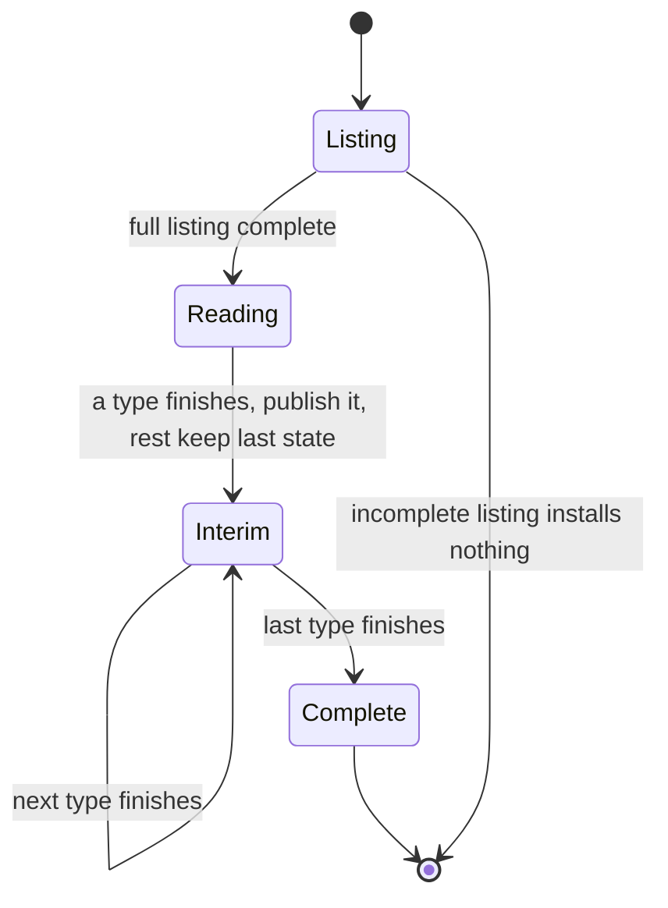
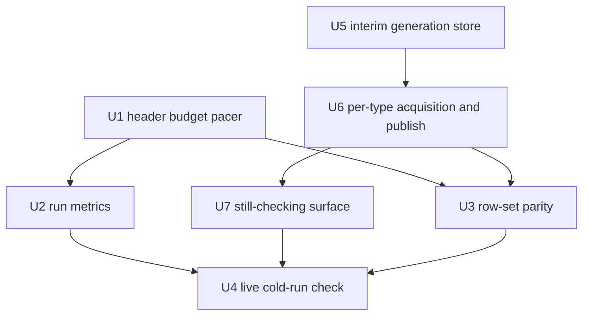

# Capacities Refresh Latency - Plan

## Goal Capsule

- **Objective:** Within about 5 minutes of a Refresh after a Capacities prep-load edit, the operator sees the plan updated for the types they prepped, with any still-unchecked types visibly marked, no 429s, and every object that counts today still counting.
- **Product authority:** this document; the operator decided the shape in dialogue on 2026-11-05. Source-health warnings and cockpit source visibility are not active scope here.
- **Open blockers:** none.

## Product Contract

### Summary

Make the plan current within about 5 minutes of a Capacities Refresh without changing which objects count or how rows are judged. The read keeps going at the API's pace, but each object type is published as soon as it is fully read, in priority order, and types still being read keep their last published state under a visible still-checking notice. Pacing follows the API's real per-endpoint budget, and each run records its own timings.

### Problem Frame

The operator preps the day's load in Capacities and then expects TDTB to show it. Today that means waiting on a Refresh that reads every object's content one at a time. The direct refresh job lists 390 objects and must read all 390, because a listing carries no typed properties, so every admission decision costs a content read. The pacer holds content reads to an assumed 30 per minute, and the run's own progress document shows 209 reads in 393 seconds — about 32 per minute, at the ceiling. A cold run is therefore roughly 12 to 13 minutes.

The cost is that prep edits are inconvenient to verify. The operator either waits out a run or works against a plan that predates the edits.

The operator believes the content quota is the assumed 30 reads per minute, which matches the observed rate. At that rate no pacing change shortens a 390-read run, and 5 minutes covers only about 150 reads. The wait therefore cannot be removed, only made visible and useful: the app currently installs exactly one complete generation or nothing, so nothing is shown until the last read. Publishing per type is the product decision this plan carries.

### Requirements

**Pacing and budget**

- R1. Content-read pacing derives its ceiling from the API's observed rate-limit headers per endpoint, and falls back to the current conservative fixed ceiling when a response carries no usable header.
- R2. No refresh emits a 429 that the pacer did not already anticipate; a 429 that still arrives is handled as it is today.
- R3. Existing concurrency rules are unchanged: one machine-local single-flight job, status queries make no provider call.

**Measurement**

- R4. A cold Refresh records its own read count, elapsed time, and steady-state reads per minute in the job document, so the 5-minute target is checkable from a completed run rather than inferred.
- R5. The admitted row set is identical before and after this change for the same Capacities data.

**Per-type publishing**

- R6. A Refresh publishes the plan as each object type finishes reading, in a priority order, while the remaining types keep reading in the same run.
- R7. A plan published before the read finishes states plainly that the read is still in progress, and names the types still unchecked.
- R8. Types still unchecked keep their last published state, and the finished read replaces the interim publication without an operator action and never mixes generations.
- R9. The operator can always see which object types were not yet fully checked; none is silently treated as unchanged.

The lifecycle R6 to R9 describe:

### Key Decisions

- Per-type publishing is the main path, not a contingency. At the believed 30 reads per minute pacing alone cannot reach 5 minutes, so waiting on a measurement would only delay the change. Pacing and metrics stay for measurement and in case the real quota is higher. Governs R6. (session-settled: user-directed — chosen over reopening a read-reducing option and over measuring first: the operator's own rules and read count stay.)
- Keep the existing admission rules as the only definition of what belongs in a plan. A tag or collection marker would make the read cheap, but it would add a habit to the operator's prep workflow. Governs R5. (session-settled: user-directed — chosen over a dedicated prep-load marker.)
- Rolling re-read of cold objects is rejected. It is the cheapest option in reads, but a newly assigned object could sit unseen until its window came round.
- Interim publication keeps unchecked types at their last published state and says so. That is visible staleness, which the operator accepted over invisible staleness.

### Acceptance Examples

- AE1. **Covers R1, R2.** Given a response whose headers state a smaller remaining budget than the assumed ceiling, when the next read is paced, then the pacer waits on that budget rather than the fixed ceiling.
- AE2. **Covers R1.** Given a response carrying no usable rate-limit header, when the next read is paced, then the current conservative ceiling applies.
- AE3. **Covers R4.** Given a completed cold Refresh, when the job document is read, then it carries the read count and the elapsed time needed to check the 5-minute target.
- AE4. **Covers R6, R7, R9.** Given a Refresh in which one type has finished and others have not, when the operator looks at the plan, then the finished type shows fresh rows, the still-checking state is visible, and the unchecked types are named.
- AE5. **Covers R8.** Given an interim publication and a later completed read, when the completed read installs, then every type reflects the new read and no row survives from a superseded interim state.

### Success Criteria

- The first interim publication appears within about 5 minutes of a cold Refresh, verified from its own job document rather than from a stopwatch.
- The admitted row set matches the previous refresh's for the same data.
- No 429 appears in a run's job document or the server log.

### Scope Boundaries

Deferred for later:

- A tag or collection prep-load marker, which would cut reads to the marked objects only.
- Rolling re-read of cold objects on a schedule.
- Any change to Todoist or calendar refresh cost.
- Diagnosing the stuck `listing`-phase job observed on 2026-11-05; it is a separate failure, not a latency question.

### How This Work Fits Together

<!-- ce-section: work-relationships -->

This plan covers Capacities refresh latency only. The wider "additional improvements" interest covered three areas; the split below is the current understanding, not a committed roadmap.

- Capacities refresh latency — this plan.
- Source health and warnings — the Press status mapping, empty-title Tasks, and Projects held for review.
  - Can proceed independently of this plan.
  - Shares the same Refresh surface, so a change to when a plan is published would be visible to it.
- Cockpit source visibility — the Calendar row, narrow-row layout, and any source filter.
  - Can proceed independently of both.
  - Shares no code path with refresh.

### Dependencies / Assumptions

- The real Capacities rate limit is per token, per endpoint, per time window, and the API publishes it in a single `RateLimit` header of the form `limit=5, remaining=4, reset=58`. The app parses none of that today; it reads `Retry-After`, `x-ratelimit-remaining`, and `x-ratelimit-reset` instead, so on current evidence the real per-endpoint budget is unknown and the 30-per-60-seconds ceiling is an assumption.
- Unverified: whether the content endpoint's quota is high enough that pacing alone reaches 5 minutes. The operator believes it is 30 per minute, in which case it is not. R4 measures it.

### Outstanding Questions

- Deferred to Planning: what the content endpoint's actual per-endpoint quota is. The operator believes it is the current 30 reads per minute, which matches the observed rate of about 32 per minute. If so, pacing alone cannot reach 5 minutes: a cold run of 390 reads needs about 13 minutes, and 5 minutes covers about 150 reads. R1 still records the observed limit at runtime and falls back to the current ceiling, so one pacer works at either quota, but R6 to R9 would then be the expected path, not a contingency.
- Deferred to Planning: the priority order in which types are read and published (KTD7). The operator preps every type, so the default is smallest first and the order is adjustable. At the believed 30 reads per minute, 5 minutes freshens about 150 objects (the four smallest types, 97 objects, and part of the fifth); the largest type finishes only when the whole run does, at about 13 minutes.
- Deferred to Planning: R2 is guaranteed only while responses carry a usable rate-limit header; with none, the fallback ceiling can still meet a lower unknown quota, and any 429 then is handled as today.
- Deferred to Planning: R6 reverses the current "complete scope or nothing" install contract, so the module contract, store invariants, and the failure wording are rewritten in U5 and U6.
- Deferred to Planning: R7's notice stays inside the existing refresh status surface, to keep cockpit source visibility out of scope; the surface is confirmed before U7.
- Deferred to Planning: whether Task, the largest type, should read first despite delaying the others, since it is likely edited most; this is a priority-order question, not a scope question.

### Sources / Research

- `app/capacities_refresh.py` — pacing policies and header observation (`DEFAULT_POLICIES` 30 per 60 s; only `Retry-After` and `x-ratelimit-*` are read), the complete-or-nothing install, and the 600 s read-through TTL.
- `app/capacities_adapter.py` — the listing carries no properties, so each property decision is a content read; `list_tags` serves display titles only, not admission.
- `docs/plans/source-refresh-latency-20261103.md` — prior read-only latency note: the direct intake makes no Capacities calls inside `/plan-inputs`, and the paced work runs in the background job.
- The run's job document under the machine-local TDTB state directory (`capacities-refresh/jobs/`) — 390 listed, 390 to read, 209 read in 393 seconds.
- Capacities API docs: rate limiting is per token, per endpoint, per window, published in one `RateLimit` header (`developers.capacities.io/api/overview/rate-limiting`); listing endpoints return only `id`, `structureId`, `title` with cursor pagination and support no modified-since filter (`developers.capacities.io/api/concepts/objects`).

---

## Planning Contract

### Key Technical Decisions

- KTD1. **One tolerant `RateLimit` parser feeding the existing `observe` seam.** A pure function in `app/capacities_refresh.py` turns response headers into a `RateLimitObservation(limit, remaining, reset_seconds)`, or `None` when nothing usable is present.
  - It accepts the combined form Capacities sends (`limit=5, remaining=4, reset=58`), the IETF structured-field keys (`q`/`r`/`t`), and the split `ratelimit-*` / `x-ratelimit-*` headers read today.
  - With several policy items, the lowest `remaining` wins.
  - Missing `remaining`, non-integer or negative values, or a `reset` above twice the fallback window count as unusable, so the fallback applies (AE2).
  - The adapter is unchanged: `_observe` already passes every response's headers, including a 429's, to the pacer.
- KTD2. **A live header budget replaces the fixed window; the window becomes the fallback.** `ProviderPacer` keeps one budget per endpoint: `remaining`, `reset_at` (monotonic), and `limit`.
  - `before_request` counts the local `remaining` down, never sends more than the header said was left, and at 0 waits until `reset_at` through the existing cooldown path.
  - While a budget is current, `DEFAULT_POLICIES` is ignored. When `reset_at` passes without a new observation the budget expires and the 30/60 window governs until the next response re-arms it.
  - This works at any quota: a header above 30 per minute raises throughput and one below lowers it (AE1).
- KTD3. **429 handling stays as it is (R2); 429s are counted, not hidden.** `call()`, `note_rate_limited`, `max_retries`, the wait budget, `progress.waiting`, and the `Cause:`/`Where:` failure lines are unchanged. The pacer adds a per-run `rate_limited` count, reset in `begin_run`. Header-budget waits still report `progress.waiting` as reset-header cooldowns do today; they are anticipated pacing, not 429s.
- KTD4. **Run metrics are additive job-document fields, timed on the wall clock.** A `progress.metrics` block is written when the read phase ends and finalized in `_finish`:
  - `reads`: fresh provider reads, equal to `progress.read`.
  - `read_started_at`, `read_finished_at`: wall-clock times of the first and last fresh read.
  - `read_rate_per_minute`: `reads` over the minutes between those two times, which excludes listing time.
  - `elapsed_seconds`: `finished_at - started_at`.
  - `cold`: true when `to_read == listed` or the mode is rescan.
  - `rate_limited`: the 429 count from KTD3.
  - `observed_limit`: the last usable `{limit, window}` for `content`, or null.

  Every value is a number, boolean, or null; nothing derived from content or exceptions is stored. `JOB_SCHEMA_VERSION` stays 1 because the loader checks only `version`.
- KTD5. **The admitted row set is proven unchanged by keeping changes away from admission (R5).** U1 and U2 do not touch `_needs_read`, `_read_or_reuse`, `items_for_day_from_objects`, the install evidence, or the read order. A parity test (U3) guards this.
- KTD6. **Per-type publishing reuses the store's retained-types mechanism.** A scoped Rescan already installs a generation in which the touched type is fresh and `retained_types` keep their published members. An interim install is the same shape: finished types fresh, unfinished types retained, plus a `partial` flag and `unchecked_types`. Governs R6, R8.
- KTD7. **Types are read and published in a priority order, not skipped.** Every mapped type can produce a plan row (assigned, active, or native mode), so there is no cheaper subset by type. The operator preps every type, so no type can be deprioritised by habit; the default order is smallest read count first, which gets the most types fresh soonest, and it is operator-adjustable. Per-object prioritisation from cached content is rejected, because a prep-load edit typically moves an object from not-today to today, so its cached copy would sort it late. The order is confirmed with the operator before U6.

### Assumptions

- The real content quota is unknown. KTD2 does not depend on it, and U4 records it through `observed_limit`.
- Capacities publishes `reset` as delta-seconds, not an epoch.
- A refresh run is sequential: one in-flight request per endpoint, so the local `remaining` countdown is exact.
- Header-reported `remaining` already accounts for other TDTB calls on the same token, such as the legacy reader and writes.

### Sequencing

U5 first, then U6 and U7. U1 and U2 are independent measurement and pacing work and may run beside them; U3 follows U1 and U6. U4, the operator-run live check, comes last.

---

## Implementation Units

### U1. Header-derived pacing budget

- **Goal:** Content, listing, and structures pacing follows the observed `RateLimit` budget, with the fixed 30/60 window as fallback.
- **Requirements:** R1, R2, R3; AE1, AE2. KTD1, KTD2, KTD3.
- **Dependencies:** none.
- **Files:** `app/capacities_refresh.py` (parser, `ProviderPacer.observe` / `before_request` / `begin_run`, module docstring "Endpoint-aware pacing" bullet); `app/tests/test_capacities_refresh.py`.
- **Patterns to follow:** the reset-header cooldown test (direct `pacer.observe("content", {...})` with the injected `Clock`/`Sleeper` from `app/tests/capacities_refresh_helpers.py`); `_coerce_seconds` for numeric coercion; cooldown waits through `_wait_after_rate_limit`.
- **Test scenarios:**
  - AE1: observe `RateLimit: limit=30, remaining=2, reset=40`. Two `before_request` calls do not sleep and the third sleeps about 40 s.
  - AE2: with no header, request 31 inside 60 s sleeps under the 30/60 window, as today.
  - Header above the fallback: `limit=120, remaining=100, reset=60` lets 31 or more requests in one window go out without sleeping.
  - Budget expiry: after `reset_at` passes with no new observation, the 30/60 window governs again.
  - Parser table: combined form; structured-field `"default";r=4;t=58`; split `x-ratelimit-*`; multi-policy takes the minimum; garbage, negative, or oversized reset returns `None`.
  - A 429 with `Retry-After` still retries and publishes (the existing test passes unchanged), and `rate_limited` increments.
  - The existing status-query-makes-no-provider-calls test still passes (R3).
- **Verification:** the focused pytest file passes, and the existing pacing, 429, budget, and cancel tests pass without edits.

### U2. Run metrics in the job document

- **Goal:** A completed run carries the numbers needed to check the 5-minute target and the no-429 criterion from its own job document.
- **Requirements:** R4; AE3; supports the Success Criteria. KTD4.
- **Dependencies:** U1, for `rate_limited` and `observed_limit`.
- **Files:** `app/capacities_refresh.py` (`_acquire` read loop, `_progress_field`, `_finish`); `app/tests/test_capacities_refresh.py`.
- **Patterns to follow:** `_progress_field` for additive persisted fields; the injected `wall_clock` in the `_coordinator` fixture; the progress `to_read` counting test.
- **Test scenarios:**
  - AE3: a cold fake run with an advancing wall clock yields `metrics.reads == progress.read`, `cold is True`, positive `elapsed_seconds`, and the expected `read_rate_per_minute`.
  - A warm run with zero fresh reads yields `reads == 0`, `cold is False`, and a null rate, without dividing by zero.
  - A run with one injected 429 that later recovers records `rate_limited == 1`.
  - Failed and cancelled runs still get `elapsed_seconds`, and no metrics value is a string derived from content or an exception.
- **Verification:** the focused pytest file passes, and a job JSON read back from `tmp_path` contains the block.

### U3. Row-set parity guard

- **Goal:** Prove neither the pacing change nor per-type publishing alters which objects are admitted once a run completes.
- **Requirements:** R5. KTD5.
- **Dependencies:** U1, U6.
- **Files:** `app/tests/test_capacities_refresh.py` only; `Clock`, `Sleeper`, and `_paged_provider` come from `app/tests/capacities_refresh_helpers.py` and are reused unchanged.
- **Patterns to follow:** the warm-refresh-publishes-complete test; the `_paged_provider` fixture with its `on_get` hook.
- **Test scenarios:** the same fake data runs under three pacing conditions, each producing identical final snapshot members and an identical `items_for_day_from_objects` id set, and one run with per-type publishing proves the final complete generation equals the single-install result.
  - The 30/60 fallback with no headers.
  - A generous header budget.
  - A tight header budget that forces waits.
  - Per-type publishing in priority order versus the old single install.
- **Verification:** the focused pytest file passes, and `git diff` shows no change to the admission code (`items_for_day_from_objects`, `_needs_read`, `_read_or_reuse`).

### U4. Live cold-run check (operator-attended, no code)

- **Goal:** Confirm from a real run that the first interim publication lands within about 5 minutes and that the final read is unchanged.
- **Requirements:** R4, R6, R7; Success Criteria.
- **Dependencies:** U1 to U3 and U5 to U7 landed. The operator restarts the server, since automated sessions must not run `tdtb-restart` or `launchctl`.
- **Files:** none. The evidence is the run's job document under the machine-local `capacities-refresh/jobs/` directory, read and never edited.
- **Procedure:** the operator runs a Rescan of all types or a Refresh more than 10 minutes after the last one. Then read `phase`, `outcome`, `progress.metrics`, per-type `progress.types` counts, `progress.publication`, and `warnings`.
- **Verification:** the first interim publication time is within about 5 minutes of the run start, `outcome: published`, `rate_limited == 0`, and the final generation's member set matches the previous complete generation for unchanged Capacities data. `observed_limit` records the real quota; if it exceeds 30 per minute, record it and revisit the pacing default.

### U5. Interim-generation support in the store

- **Goal:** The store can install a generation marked partial with named unchecked types, built from finished types plus the retained published members of unfinished ones, and a later complete install supersedes it whole.
- **Requirements:** R6, R8. KTD6.
- **Dependencies:** none.
- **Files:** `app/capacities_refresh_state.py` (install evidence and snapshot gain `partial` and `unchecked_types`; reuse the `retained_types` path; the complete install replaces the interim with no member merge); its focused test file.
- **Patterns to follow:** existing `install_generation` and `expected_generation` conflict handling.
- **Test scenarios:**
  - AE5: install interim, then complete. No member survives that the complete read removed.
  - An interim install keeps the retained types' prior members and marks `partial`.
  - An interim install never replaces a newer complete generation.
  - An incomplete listing still installs nothing.
- **Verification:** the store test file and the full backend suite pass.

### U6. Per-type acquisition and publish

- **Goal:** The coordinator reads types in priority order, installs an interim generation as each finishes, and installs the complete one after the last, inside the same single-flight job.
- **Requirements:** R6, R8, R9. KTD6, KTD7.
- **Dependencies:** U5.
- **Files:** `app/capacities_refresh.py` (`_acquire` split; job `progress.publication` and `progress.unchecked_types`); `app/tests/test_capacities_refresh.py`.
- **Test scenarios:**
  - The interim generation is published after the first type finishes and before any read of a later type, with `unchecked_types` named.
  - The priority order puts the last published plan's types first, then smaller types.
  - Cancellation, staleness, or failure mid-run leaves the last interim in place, flagged partial, with a truthful warning.
  - The complete install clears the flag.
  - Single-flight holds across the whole run.
- **Verification:** the focused pytest file and the full backend suite pass.

### U7. Still-checking surface

- **Goal:** The operator sees that the read is still in progress and which types are unchecked.
- **Requirements:** R7, R9; AE4.
- **Dependencies:** U6.
- **Files:** `frontend/src/adapters/wire.ts` (project `publication` and `unchecked_types` with conservative defaults); the existing refresh status surface under `frontend/src/ui/`, confirmed before this unit starts; one focused frontend test.
- **Test scenarios:**
  - AE4: a partial payload renders a still-checking state and the unchecked type names.
  - A complete payload renders no partial notice.
  - A malformed payload projects to the empty state.
- **Verification:** `npm test`, `npm run typecheck`, `npm run build:mockup`, and `npm run build:prod` from `frontend/`, plus a scratch fixture walkthrough with zero billed calls.

---

## Verification Contract

| Scope | Command / check | Applies to |
|---|---|---|
| Focused backend | `python3 -m pytest app/tests/test_capacities_refresh.py -q` | U1, U2, U3, U6 |
| Store | the `capacities_refresh_state` focused test file | U5 |
| Full backend | the backend pytest suite, including the bootstrap runner tests the repo's `AGENTS.md` names | every landing |
| Frontend | `npm test`, `npm run typecheck`, `npm run build:mockup`, `npm run build:prod` in `frontend/` | U7 only |
| Hygiene | `git diff --check` on owned paths | every landing |
| Target | U4 job document: first interim publication within about 300 s of a cold run, `rate_limited == 0`, final member set unchanged | live check |

All automated tests use the injected `Clock`/`Sleeper` and `tmp_path`, with no provider, credential, or machine-local state access.

---

## Definition of Done

- Global: U1 to U7 are complete, and a live cold job document shows the first interim publication within about 300 s, `rate_limited == 0`, and an unchanged final member set (U4).
- Global: no exception text, header text, or path reaches a warning or job field. Single-flight and status-without-provider-call are unchanged.
- Global: abandoned-attempt code and experimental pacer variants are removed from the diff.
- U1: the AE1 and AE2 tests pass and existing pacing tests pass unedited.
- U2: AE3 passes and the metrics block appears on complete, failed, and cancelled runs.
- U3: three-condition parity holds.
- U4: the measurement and the observed quota are recorded in TDTB's restartable state surface, not in this plan.
- U5 to U7: AE4 and AE5 pass, and the module contract and failure wording describe the new interim behavior.
