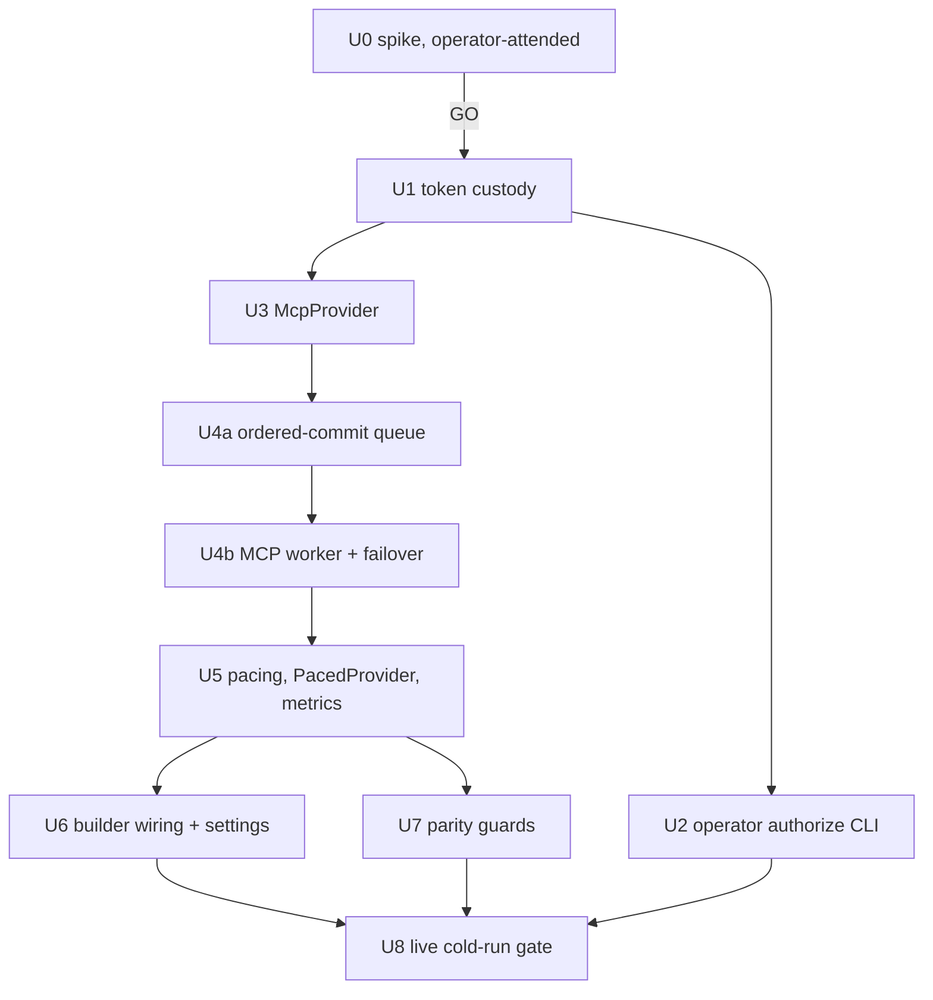

# Capacities MCP Read Provider - Plan

## Goal Capsule

- **Objective:** Bring a cold Capacities Refresh (390 objects, about 13 minutes today) down to about 4-5 minutes by reading object content from two independent sources at the same time: the REST `GET /object` bucket at its measured 30 per 60 s, and Capacities' hosted MCP `getObjectContent` at its own ~35 per 60 s. Which objects count and how they are judged stay the same, and a total MCP failure degrades to the existing REST-only path rather than failing the run.
- **Product authority:** this document. It builds on the 2026-11-05 latency plan, whose per-type publishing (U5-U7), one-shot transient retry, and `progress.metrics` are already landed and stay unchanged.
- **Open blockers:** none for U1-U8. U0 returned GO on measured evidence (see U0). One residual check is still unmeasured: refresh-token survival after 24 h idle and across a reboot. If that check fails, the original no-go rule applies.

## Product Contract

### Summary

Only the content-read transport changes, and the content-read phase now splits across two independent budgets. Listing, structures, writes, admission rules, admission order, and publication stay on their current paths. A shared work queue of object reads is drained by one REST worker, paced on the existing `content` endpoint at 30 per 60 s, and one MCP worker, paced on a new static `mcp_content` policy at about 35 per 60 s - roughly 60% of the measured ~58-60 per 60 s ceiling. Results are re-ordered back into the existing priority order before admission and interim publishing, so the published row set and order are the same as an all-REST run whichever source read which object. Measured combined throughput is about 88 reads per 60 s, or roughly 4.4 minutes for 390 cold reads; U8 confirms or corrects that estimate. Any MCP authorization, session, or throttle failure stops only the MCP worker and requeues its in-flight object to REST, so a refresh never fails because of MCP.

### Problem Frame

- Every admission decision costs one content read, because REST listings carry no properties (`app/capacities_adapter.py:3785-3815`).
- `GET /object` is documented and measured at 30 per 60 s. That caps a 390-read cold run at about 13 minutes, and no pacing change shortens it (2026-11-05 plan, Outstanding Questions).
- Measured MCP ceiling (U0, 2026-11-06): about 58-60 requests per rolling 60 s, then HTTP 429 with `Retry-After` about 39 s and Cloudflare headers. p50 latency 281 ms, p95 736 ms, 57 successful calls in 21.4 s. Sequential MCP-only therefore costs about 6.5-7 minutes for 390 reads, which misses the target.
- MCP authenticates with OAuth (scope `mcp:read mcp:write`), not TDTB's REST bearer token. U0 held REST at 30.4 per minute with zero 429s both alone and while MCP completed 174 calls, so the two budgets are independent: 30 + ~58 concurrent is the only measured configuration that reaches the target.
- A transport 429 destroys the `mcp==1.28.1` session. `raise_for_status` inside the task group cancels the in-flight call and the real error surfaces on context exit, so throttling must be handled as source loss, not as a retryable read.

### Requirements

**Parity**

- R1. For the same Capacities data, the admitted row set, published members, and admission order are identical to an all-REST run, regardless of which source read which object, and including a run where MCP dies partway or is throttled.
- R2. Listing, structures, and patch stay on REST. MCP is used only for content reads, so enumeration and the "complete scope or nothing" install contract are unchanged.
- R3. Content returned from MCP is checked against the configured space and normalized to the REST content shape before the store sees it.

**Throughput and pacing**

- R4. MCP content reads are paced under their own endpoint budget. The budget is static and conservative, set from U0's measured ceiling. MCP pacing never consumes or delays the REST `content` budget.
- R5. A cold run using both sources finishes its read phase within the U8 target - about 4.4 minutes estimated for about 390 reads, gated at about 5 minutes - measured from its own job document.

**Fallback and safety**

- R6. The run falls back to REST for its remaining reads, and still completes, if MCP authorization fails, the token file is missing or invalid, the session cannot open, the tool is unavailable, MCP is throttled, or MCP fails repeatedly. The MCP worker's in-flight object is requeued to REST, so no read is lost. The run adds exactly one bounded, secret-free warning.
- R7. Each run records `read_source` (`mixed`, `rest`, or `mcp`), per-source read counts, and per-source elapsed time in `progress.metrics`. `JOB_SCHEMA_VERSION` stays 1.
- R8. MCP access tokens, refresh tokens, client secrets, authorization codes, and OAuth response bodies never appear in the repo, logs, job documents, warnings, exceptions surfaced to callers, or argv.
- R9. Initial OAuth consent is an operator-attended, operator-run step. TDTB never opens a browser, never starts an authorization flow from the server, and never performs dynamic client registration from the server.
- R10. Single-flight, cancellation, status-without-provider-call, interim publishing, per-type completion, the per-type unreadable handling, and the one-shot transient retry are unchanged. At most two content reads are ever in flight, one per source, and both workers honour `cancel_event` and are joined on cancel or failure.
- R11. The read phase is a shared work queue with an ordered commit: results are re-ordered into the existing priority order before admission and interim publishing, so a worker's completion order never reaches admission.
- R12. MCP is enabled only by the `read_source` setting, whose default `rest` preserves today's sequential REST-only path as the kill switch. `auto` enables the splitter only when a valid custody file exists.
- R13. A throttle or transport failure on MCP is never a read retry: it is source loss, so it does not increment `retried_reads`, does not mark an object unreadable, and does not consume the one-shot transient retry.

### Key Decisions

- **MCP replaces content reads only, not listing.** REST lists by structure id with cursor pagination (`capacities_adapter.py:3804-3815`). MCP lists by object type name (`capacities_listObjectsByObjectType(objectType, pageSize, cursor)`), and that mapping is unverified. Listing is a few dozen calls against 390 content reads, so moving it buys almost nothing and risks R1. `McpProvider.list_objects` is not implemented. The splitter delegates listing, structures, and patch to REST. U0 measured the structureId-to-objectType map only as read-keying evidence (KTD5), not as a listing route.
- **REST stays primary for writes and the fallback for reads.** `patch_object` is never routed to MCP, even though the scope includes `mcp:write`.
- **Concurrent split across two independent budgets, not a preference chain.** U0 proved REST and MCP budgets are independent (REST 30.4/min with zero 429s while MCP ran 174 calls) and that MCP alone caps at ~58-60/min, so a sequential MCP-preferred router reaches ~7 minutes and a REST-only fallback chain reaches ~13. The target needs both budgets at once. The read phase therefore becomes a shared queue drained by one REST worker and one MCP worker with an ordered commit, capped at two in-flight reads. This supersedes the 2026-11-05 one-in-flight assumption for content reads only; the parity test asserting read order stays authoritative (R11).
- **Completion re-reads stay REST.** `CapacitiesAdapter.complete` re-reads through `provider.get_object` for its optimistic-concurrency guard. That re-read stays REST-only so the guard has exactly one source and one ordering, rather than racing the splitter's queue.
- **Throttling is source loss, not backoff.** A transport 429 destroys the `mcp==1.28.1` session: `raise_for_status` inside the task group cancels the in-flight call and the real error surfaces on context exit. So a 429 stops the MCP worker, rebuilds the session only after the `Retry-After` cooldown, requeues the in-flight object to REST, and never counts as a read retry.
- **OAuth metadata must be pre-set.** `mcp==1.28.1` refreshes against `/token` unless `auth.context.oauth_metadata` is populated first, which 404s. `McpProvider` pre-loads it from `https://api.capacities.io/.well-known/oauth-authorization-server`; the token endpoint is `/oauth/token` and the access token lives 24 h.
- **Refresh tokens rotate.** Every refresh returns a new refresh token, so custody writes must be atomic and serialized under the existing lock or a crash loses the credential permanently.
- **Explicit setting toggles MCP (operator decision, 2026-11-06).** Enablement is a key in the strict Capacities settings document (`read_source`: `auto` or `rest`, default `rest`), which needs a settings schema version bump and a migration that leaves existing documents valid. MCP is used only when the setting is `auto` AND a valid machine-local custody file exists; the custody file alone never enables it. Setting `rest` is the kill switch. U6 owns the settings change.

### Acceptance Examples

- AE1. **Covers R1, R2, R11.** Given the parity fixture, when one run reads content through REST only, one through the REST+MCP splitter, one where MCP fails after its second read, and one with a tight `mcp_content` policy forcing waits, then members, admitted item ids, and admission order are equal in all four, and listing calls hit REST in every run.
- AE2. **Covers R6, R7, R8.** Given an MCP session whose auth raises `OAuthTokenError`, when a cold Refresh runs, then `outcome: published`, `read_source == "rest"`, `mcp_reads == 0`, `read_source_fell_back` is true, and exactly one fallback warning is present. No warning, job field, or captured log line contains the fake token strings.
- AE3. **Covers R1, R6, R12.** Given MCP failing mid-run while a read is in flight, when the run completes, then that object is still published, `mcp_reads + rest_reads == 4`, `read_source == "mixed"`, and members and admission order equal the all-REST run.
- AE4. **Covers R3.** Given MCP content whose `spaceId` differs from the configured space, when it is read, then that read is a contract error (deterministic, not retried), and nothing from it is stored.
- AE5. **Covers R4.** Given both budgets, when 40 MCP reads run, then the REST `content` window is untouched and MCP reads wait only on the `mcp_content` policy.
- AE6. **Covers R13.** Given an MCP transport 429 mid-run, when the MCP worker stops, then `rate_limited` is not incremented, no object is unreadable, `retried_reads` is unchanged, and the run publishes through REST alone.

### Success Criteria

- A live cold Refresh's job document shows `read_source: "mixed"` with both `rest_reads` and `mcp_reads` above zero, per-source elapsed times, `rate_limited == 0`, and a read phase of about 4.4 minutes for about 390 reads. That figure is an estimate from measured per-source ceilings and is confirmed or corrected by U8.
- Its final member set and admitted row ids equal a REST-only run over the same data.
- A run with the token file removed completes through REST with one fallback warning and `read_source: "rest"`.

### Scope Boundaries

Deferred:

- MCP listing (`capacities_listObjectsByObjectType`) and any structureId-to-objectType mapping beyond the read-keying rule in KTD5.
- More than two content workers, or any worker that spans endpoint budgets.
- MCP writes.
- `capacities_search` or `capacities_readObjectBlocks`.
- The REST `GET /object/markdown` second bucket.
- Automated or server-initiated re-consent.
- A cockpit UI for MCP auth state. The fallback warning travels on the existing refresh status surface.

### Dependencies / Assumptions

- `mcp==1.28.1` and `anyio==4.14.2` are already pinned (`app/requirements.txt:18,35`). No new dependency.
- `OAuthClientProvider` is an async `httpx.Auth` (`oauth2.py:217`). The refresh coordinator is synchronous and threaded (`capacities_refresh.py:1424`). The sync facade runs the async client on an `anyio.from_thread.start_blocking_portal()` portal (`anyio/from_thread.py:504`).
- Capacities' MCP authorization server supports refresh tokens and either dynamic client registration or CIMD; headless refresh works with no browser (U0 step 1).

### Outstanding Questions

- Resolved: `mcp` exposes `TokenStorage` (async `get_tokens`, `set_tokens`, `get_client_info`, `set_client_info`; `oauth2.py:72-90`) and auto-refresh when `is_token_valid()` is false and `can_refresh_token()` is true (`oauth2.py:500-508`).
- Resolved, risk: after a process restart, `_initialize` loads tokens but never sets `context.token_expiry_time` (`oauth2.py:475-479`). `is_token_valid()` then returns true for an expired access token (`oauth2.py:129-135`). The server answers 401, and the library starts the full authorization flow (`oauth2.py:512` onward) instead of refreshing. Headless, that raises `OAuthFlowError("No redirect handler ...")` (`oauth2.py:320-321`).
  - Mitigation (KTD3): custody persists an absolute expiry, and `McpProvider` pre-sets `auth.context.token_expiry_time` before the first request.
- Resolved, risk: on a 401 with no stored `client_info`, the library performs dynamic client registration before failing (`oauth2.py:572-594`). The server must therefore only run with stored client info. Custody refuses to construct the provider without it.
- Resolved by U0: a fresh process with a forced-past access token refreshes headless and needs no browser, but only after `auth.context.oauth_metadata` is pre-set from `https://api.capacities.io/.well-known/oauth-authorization-server`. Without it the library refreshes against `/token` and gets a 404. The token endpoint is `/oauth/token` and the access token lives 24 h.
- Resolved by U0: refresh tokens rotate on every refresh, so custody must write atomically under the lock (KTD2) or a crash strands the credential.
- Resolved by U0: throttling surfaces as an HTTP 429 on the transport with `Retry-After` about 39 s and Cloudflare headers. It destroys the `mcp==1.28.1` session, so it is source loss, not a retryable read (KTD7).
- Resolved by U0: the content tool is resolved by suffix `getObjectContent` (the harness adds a `capacities_` prefix, the server's own tool names are unprefixed), takes argument `id`, and result arrives as `structuredContent` dict.
- Still unmeasured: refresh-token survival after 24 h idle and across a reboot. This is U0's residual operator check and U8's precondition.

### Sources / Research

- The files listed in the evidence envelope.
- U0 spike measurements, 2026-11-06: headless refresh pass, MCP ceiling and 429 shape, quota independence, and 42-object payload parity. Scratch scripts live outside the repo in `~/scratch/tdtb-mcp-spike`.

---

## Planning Contract

### Key Technical Decisions

- KTD1. **A dual-source concurrent splitter, not a router with a preference.** A new `CapacitiesContentSplitter` in `app/capacities_read_source.py` implements the provider protocol and owns the content-read phase.
  - `fetch_structures`, `list_objects`, `patch_object`, `base_url`, `supports_object_listing`, and `set_rate_observer` delegate to the REST client. The REST header observer keeps working (`capacities_refresh.py:863-865`). The completion re-read also stays REST (`get_object(..., for_completion=True)`), per the decision in Key Decisions.
  - For content reads it primes a priority-ordered work queue with the ids the coordinator is about to read (`prime(ids)` per type batch, preserving per-type completion) and exposes `get_object(id)` in the same order the coordinator consumes today. Each primed id is claimed by whichever worker - REST or MCP - is free, paced on its own endpoint. At most two reads are in flight, one per source.
  - Completed results land in a slot array keyed by the primed index and are released to `get_object` strictly in priority order, so worker completion order never reaches admission, interim publishing, or `_fingerprint` comparisons (R11).
  - Neither worker may read an id outside its own primed batch, and both stop on `cancel_event`. `end_run` joins both workers before closing MCP, so no worker outlives a run, a cancel, or a failure.
  - Counters: `read_counts()` returns `{"rest": n, "mcp": n, "fell_back": bool}` plus per-source elapsed seconds.
- KTD2. **Token custody (`app/capacities_mcp_auth.py`).** `FileTokenStorage` implements `mcp.client.auth.TokenStorage`.
  - It holds one JSON document: `{"version": 1, "client_info": {...}, "tokens": {...}, "access_expires_at": <epoch|null>}`.
  - Default path is `~/.config/tdtb/capacities-mcp/oauth.json`, in its own 0700 directory because the shared `~/.config/tdtb` is 0755. It is outside synced folders.
  - The directory is 0700 and the file 0600. Writes are atomic: an `O_EXCL` 0600 temp file plus rename, the pattern at `capacities_settings.py:1253`. Like `load_capacities_token` (`capacities_builder.py:217-230`), any mode looser than 0600 is rejected.
  - Refresh tokens rotate on every refresh (U0), so `set_tokens` must complete its temp-write and rename while holding the custody lock: a crash between the server's rotation and the write strands the credential. Single-writer assumption: only the TDTB server process refreshes while a job runs.
  - `set_tokens` also keeps the previous `refresh_token` when the new token lacks one, and stores `access_expires_at = now + expires_in`.
  - All errors are `CapacitiesMcpAuthError` with fixed messages: no path, no value, no response body.
- KTD3. **Headless-safe OAuth construction.** `McpProvider` builds `OAuthClientProvider(server_url, client_metadata, storage, redirect_handler=None, callback_handler=None)` (`oauth2.py:225-233`).
  - Before the first request it sets `auth.context.token_expiry_time` from `access_expires_at`. An expired token then refreshes instead of 401-ing into the full flow.
  - It also pre-sets `auth.context.oauth_metadata` from `https://api.capacities.io/.well-known/oauth-authorization-server`. Without this, `mcp==1.28.1` refreshes against `/token` and gets a 404 (U0 step 1). The correct token endpoint is `/oauth/token`.
  - It refuses to start if stored `client_info` or `refresh_token` is absent. This prevents server-side registration (R9).
  - Any `OAuthFlowError`, `OAuthTokenError`, `OAuthRegistrationError`, HTTP 401/403, or `CapacitiesMcpAuthError` becomes `capacities_adapter.CapacitiesReadSourceUnavailable`, a new class with no message payload.
- KTD4. **Sync facade over one portal per run, one session per source.** `McpProvider` opens the portal, the `httpx.AsyncClient(auth=...)`, the `streamable_http_client(url, http_client=client)` (`streamable_http.py:600-605`), and `ClientSession(...).initialize()` lazily on the first MCP read.
  - The content tool is resolved by suffix `getObjectContent` rather than by literal name, because the harness prefixes tools with `capacities_` while the server's own names are unprefixed.
  - Each `call_tool` has `read_timeout_seconds` of 15 s and passes `id` as the only argument.
  - After a 429 the session is unusable (see Key Decisions), so `McpProvider` discards it and rebuilds it only after the `Retry-After` cooldown has elapsed. Rebuild is attempted at most once per cooldown; a second failure inside the cooldown means the MCP worker stays off for the rest of the run.
  - `PacedProvider` gains duck-typed `begin_run()`/`end_run()` passthroughs. `RefreshCoordinator._run` calls them, with `end_run` in a `finally`.
- KTD5. **Result normalization (R3) - exactly three rules.** U0's 42-object parity run (all 7 mapped types including `RootTask`) matched TDTB's `_fingerprint` 42/42 after these rules and nothing else.
  - (i) Stamp `structureId` from the REST listing row that requested the read. MCP's `objectTypeId` equals REST's `structureId` for all 7 types, including the literal `RootTask` whose MCP `objectType` display name is `Task`. Never key off `objectType` name.
  - (ii) Drop top-level `spaceId`, which REST does not send but `_fingerprint` hashes.
  - (iii) Strip per-element `title` from entity-reference lists inside `properties` (MCP sends `{id, title}`, REST sends `{id}`; 44 refs differed in U0 and all are explained by this rule).
  - Everything else in the MCP payload (`content`, `createdAt`, `lastUpdated`, `objectType`, `objectTypeId`, `title`, `tags`, `collections`, `blocks`) is dropped or ignored, because TDTB's admission provably ignores it. The title fallback already lives in the adapter.
  - `isError`, multiple content parts, non-JSON text, a non-dict `properties`, or a present `spaceId` that differs from the configured space raise `CapacitiesContractError` with a fixed message. That class is deterministic and not retried (`capacities_refresh.py:549-551`).
  - A unit test pins each of the three rules against a captured payload pair.
- KTD6. **Pacing: two independent static budgets.** Add `ENDPOINT_MCP_CONTENT = "mcp_content"` to `DEFAULT_POLICIES` (`capacities_refresh.py:228-232`) with a static `EndpointPolicy` of about 35 per 60 s - roughly 60% of U0's measured 58-60 per 60 s ceiling, leaving headroom for latency jitter and retry bursts. U8 may retune it once.
  - REST stays at its existing `ENDPOINT_CONTENT` 30 per 60 s. Neither pacer ever waits on the other; that is what makes the split additive rather than a preference chain.
  - MCP has no header observer. The REST observer only ever reports REST endpoints.
  - An MCP 429 is not fed to `pacer.call` backoff as a read retry: the MCP worker stops, its in-flight object is requeued to REST, and the run continues REST-only (KTD7, R13).
- KTD7. **Failover mechanics.** `PacedProvider.get_object` asks the splitter for the next ordered result and lets the splitter decide which worker owns the id; pacing happens inside each worker on its own endpoint.
  - When the MCP worker raises `CapacitiesReadSourceUnavailable`, the splitter requeues that exact id to the REST worker and marks `fell_back`. The exception never reaches `_read_object`, so it is neither an unreadable object nor a transient retry.
  - `fell_back` means the MCP worker is off for the rest of the run. The REST worker drains the whole remaining queue, which is exactly today's sequential REST path.
  - Circuit breaker: 3 consecutive MCP failures (any cause) switch the worker off, even if each failure alone was recoverable. A success resets the consecutive count.
  - Cancellation: `cancel_event` is checked by both workers before every request and while waiting on a pacer slot.
- KTD8. **Metrics and warning.** `_build_metrics` (`capacities_refresh.py:1552-1605`) adds `read_source` (`mixed`, `rest`, or `mcp`), `mcp_reads`, `rest_reads`, `rest_read_seconds`, `mcp_read_seconds`, and `read_source_fell_back`. `JOB_SCHEMA_VERSION` stays 1.
  - A fixed `MCP_FALLBACK_WARNING` constant joins the warnings, at most once per run: "Capacities fast read was unavailable; this refresh read through the standard API at the normal pace."
- KTD9. **Log hygiene.** The `mcp` library logs `Token refresh failed: <status>` and `logger.exception("OAuth flow error")` (`oauth2.py:456,597`). `_handle_token_response` builds exception text from the response body (`oauth2.py:411-414`).
  - `McpProvider` never re-raises library exceptions to callers. It installs a logging filter on the `mcp.client.auth` logger that drops records carrying `exc_info` and redacts the message to the logger name plus status.
  - A caplog test asserts no fake secret appears.
- KTD10. **Enablement gate (R12).** `read_source` in the strict Capacities settings document selects the mode: `rest` (default) builds the existing sequential REST-only coordinator with no splitter and no MCP import at read time; `auto` builds the splitter and uses MCP only when a valid custody file exists.
  - The custody file alone never enables MCP, and `rest` is the documented kill switch.
  - The settings change needs a schema version bump and a migration that leaves existing documents valid. U6 owns it.

### Assumptions

- U0's payload parity holds outside the sampled object shapes. The 42-object sample contained no empty-Status Projects and no entity-typed properties, so U7 must supply fixtures for both rather than lean on the spike.
- ~35 MCP reads per minute plus 30 REST reads per minute is sustainable for the ~4.5 minutes a cold run needs; U8 measures it and may retune `mcp_content` once.
- The refresh token survives 24 h idle and a reboot. Still unmeasured; if it fails, the no-go rule in U0 applies.
- Only the TDTB server process refreshes tokens after consent. The operator authorize CLI runs only while no refresh job is active. Refresh-token rotation could race between processes, so a 0600 lock file guards `set_tokens`.

### Sequencing

U2 and U3 may run in parallel after U1, on disjoint files. U4a lands before U4b, because REST-only equivalence must be provable without any MCP code. All others run serially.

---

## Implementation Units

### U0. Feasibility spike (operator-attended, no production code)

- **Goal:** Prove or disprove the four unknowns before any production code is written.
- **Requirements:** gates everything; informs R4, R5, R6, R9, KTD3, KTD5, KTD6.
- **Dependencies:** none.
- **Owner:** the operator runs it. An agent may draft scratch scripts but cannot perform consent.
- **Files:** none in the repo.
  - Scratch scripts live outside the repo in `~/scratch/tdtb-mcp-spike/`. They are run with `app/.venv/bin/python -I` and use a scratch token file there (0600).
  - Evidence is a secrets-free summary appended to TDTB's restartable state surface.
- **Procedure:**
  1. **Headless refresh.** The operator consents once with a scratch `OAuthClientProvider` using a loopback redirect handler. Record whether registration was DCR or CIMD. Then, in a new process with `redirect_handler=None`:
     - (a) read 5 objects;
     - (b) force-expire the stored access token and repeat, with and without pre-setting `context.token_expiry_time` (confirms the KTD3 restart bug and its fix);
     - (c) idle at least 24 h (and ideally across a reboot), then repeat (`s1_headless.py --idle-check`);
     - (d) record `expires_in`, whether refresh rotates `refresh_token`, and whether a refresh response omits it.
  2. **Quota independence.** Run TDTB's REST pacer pattern at 30 per 60 s for 3 minutes alone, recording REST `RateLimit` remaining values. Repeat while MCP reads run continuously in a second process. Independence means REST remaining/reset sequences and throughput are unchanged and there are zero REST 429s.
  3. **MCP ceiling and latency.** Read sequentially without pacing for up to 3 minutes or until the first throttle signal, capped at 600 calls. Record:
     - p50/p95 per-call latency;
     - sustained reads per minute;
     - the exact throttle shape (HTTP status, JSON-RPC error, or `isError`) and any Retry-After.
     Stop at the first throttle.
  4. **Payload diff.** For at least 40 objects, read both REST `GET /object` and MCP `capacities_getObjectContent` and diff field by field: key set, `properties` values, `tags`, `collections`, `lastUpdated` format, and `_fingerprint` after normalization. The sample includes:
     - empty-Status Projects;
     - label, date or date-range, and entity properties;
     - at least one object per mapped type;
     - `structuredContent` versus `TextContent` delivery.
     Also record for each type which `objectType` value MCP reports against REST `structureId`. This is evidence only; listing stays REST.
- **Results (2026-11-06, measured):**
  - Step 1(b) **PASS**: a fresh process with a forced-past access token refreshed headless with no browser. It needs `auth.context.oauth_metadata` pre-set from the well-known document first, otherwise the library refreshes against `/token` and gets a 404. Token endpoint `/oauth/token`, access token 24 h.
  - Step 1(d) **PASS, with a constraint**: the refresh token rotates on every refresh, so custody writes must be atomic and locked (KTD2).
  - Step 1(c) **NOT MEASURED**: refresh-token survival after 24 h idle and across a reboot still needs the operator's `--idle-check`. The no-go rule below still governs.
  - Step 2 **PASS**: REST held 30.4 per minute with zero 429s both alone and while MCP completed 174 calls. The budgets are independent, so ~30 + ~58 per minute is available concurrently.
  - Step 3 **PASS**: ceiling about 58-60 per rolling 60 s, then HTTP 429 with `Retry-After` about 39 s and Cloudflare headers. 57 calls succeeded in 21.4 s, p50 281 ms, p95 736 ms. MCP-only over 390 reads is about 6.5-7 minutes, which misses the target. A transport 429 destroys the session: `raise_for_status` inside the task group cancels the in-flight call and the real error surfaces on context exit.
  - Step 4 **PASS**: the final 42-object run had 0 errors across all 7 mapped types including `RootTask`, and `_fingerprint` matched 42/42 with zero admission-relevant diffs after exactly three normalization rules (KTD5). Caveat: the sample held no empty-Status Projects and no entity-typed properties, so U7 supplies those fixtures.
  - Also recorded: the content tool resolves by suffix `getObjectContent`, takes `id`, and returns `structuredContent`.
- **Go/no-go:**
  - **GO (returned 2026-11-06)** for U1-U8, on the four measurements above. The throughput criterion is met by the dual-source split rather than by sequential MCP: independence is proven, so ~30 + ~58 concurrent reads per minute reaches ~4.4 minutes for ~390 reads.
  - **Residual rule that can still close the plan:** if the 24 h idle / reboot check shows the refresh token does not survive, headless MCP would need a browser every day. Then the original no-go rule applies, and this plan closes as no-go with the evidence recorded; U1-U8 are not built.
  - A payload diff on any admission-read field is still no-go until a normalization rule is agreed.

### U1. Token custody module

- **Goal:** A file-backed `TokenStorage` that is safe headless and never leaks.
- **Requirements:** R8, R9; KTD2.
- **Dependencies:** U0 GO.
- **Files:** `app/capacities_mcp_auth.py` (new); `app/tests/test_capacities_mcp_auth.py` (new).
- **Size:** 2 files, about 25 tool calls.
- **Patterns:** `load_capacities_token` mode check (`capacities_builder.py:217-230`); the 0600 `O_EXCL` write (`capacities_settings.py:1253`); owner-only modes in `capacities_tag_titles.py:73,120-127`.
- **Test scenarios:**
  - round-trip `set_tokens`/`get_tokens`/`set_client_info`/`get_client_info` through `asyncio.run`;
  - the file is 0600 and the directory 0700;
  - a 0644 file is rejected;
  - a refresh without `refresh_token` keeps the old one;
  - `access_expires_at` is persisted;
  - error messages contain no path or token;
  - a missing file means "not configured", not a crash.
- **Focused test:** `python3 -m pytest app/tests/test_capacities_mcp_auth.py -q`.

### U2. Operator authorize CLI (operator-run only)

- **Goal:** One command the operator runs by hand to perform consent and write the custody file.
- **Requirements:** R8, R9.
- **Dependencies:** U1.
- **Files:** `app/capacities_mcp_authorize.py` (new; `python -m` entry, loopback `127.0.0.1` redirect on an ephemeral port using stdlib `http.server`); `app/tests/test_capacities_mcp_authorize.py` (new).
- **Size:** 2 files, about 30 tool calls.
- **Behavior:**
  - prints the authorization URL to stdout and opens no browser itself;
  - never prints or logs the code or tokens;
  - refuses to run when the refresh job lock is held;
  - is not imported by `main.py` or any route.
- **Test scenarios:**
  - with a fake `OAuthClientProvider` flow, the callback handler returns `(code, state)` and the file is written 0600;
  - caplog/stdout contains no fake code or token;
  - an import-graph test asserts `main` and `capacities_refresh` do not import this module.
- **Focused test:** its own test file.

### U3. McpProvider (content reads only)

- **Goal:** A synchronous `get_object(object_id, structure_id)` over MCP that returns REST-shaped content.
- **Requirements:** R3, R6, R8; KTD3, KTD4, KTD5, KTD9.
- **Dependencies:** U1.
- **Files:** `app/capacities_mcp.py` (new); `app/capacities_adapter.py`, which only gains the `CapacitiesReadSourceUnavailable` class next to `CapacitiesRateLimited` (`:71-87`); `app/tests/test_capacities_mcp.py` (new).
- **Size:** 3 files, about 35 tool calls.
- **Interface:**
  - `McpProvider(space_id, storage, *, server_url="https://api.capacities.io/mcp", session_factory=None, timeout=15.0)`;
  - `begin_run()`, `end_run()`, `get_object(object_id, *, structure_id)`, `close()`.
  - `structure_id` comes from the REST listing row that queued the read and is required, because normalization rule (i) needs it.
  - The injectable `session_factory` returns an async context manager yielding an object with `call_tool(name, arguments, read_timeout_seconds=...)`. Tests use it, so no network is touched.
  - The content tool is resolved by suffix `getObjectContent`; the call passes `id` only.
  - A throttle raises `CapacitiesReadSourceUnavailable` carrying `retry_after`, and discards the session so the next attempt rebuilds it after the cooldown.
- **Normalization (KTD5), exactly three rules:** stamp `structureId` from the calling listing row; drop top-level `spaceId`; strip per-element `title` from entity-reference lists inside `properties`. Nothing else is rewritten.
- **Test scenarios:**
  - the three normalization rules are pinned individually against a captured REST/MCP payload pair, and the normalized MCP payload's `_fingerprint` equals REST's;
  - `structuredContent` and `TextContent` JSON both normalize identically;
  - `isError` or garbage raises `CapacitiesContractError`;
  - a mismatched `spaceId` raises `CapacitiesContractError` (AE4);
  - fake `OAuthTokenError`/401 raises `CapacitiesReadSourceUnavailable` with an empty message;
  - an expired stored token pre-sets `token_expiry_time` to the past;
  - `oauth_metadata` is pre-set before the first request, so a refresh hits `/oauth/token` and never `/token`;
  - missing `client_info` raises unavailable before any request;
  - a 429 raises `CapacitiesReadSourceUnavailable` with `retry_after` and forces a fresh session on the next attempt;
  - caplog contains no fake secret.
- **Focused test:** `python3 -m pytest app/tests/test_capacities_mcp.py -q`.

### U4a. Ordered-commit content queue (REST-only, no flag)

- **Goal:** The ordered-commit machinery that makes any read-source mix indistinguishable from today's sequential REST reads, provable with REST alone.
- **Requirements:** R1, R10, R11; KTD1.
- **Dependencies:** none; the queue is pure REST-side machinery. It is sequenced after U3 only so that U4a and U4b never edit `app/capacities_read_source.py` concurrently.
- **Files:** `app/capacities_read_source.py` (new; `ContentCommitQueue` plus the REST-only splitter shell); `app/tests/test_capacities_read_source.py` (new).
- **Size:** 2 files, about 25 tool calls.
- **Behavior:**
  - `prime(ids)` records the priority-ordered ids for the current type batch; a claim cursor hands out the next index under a lock; results land in a slot array; `get_object` releases slots strictly in primed order and blocks only when its own slot is still pending.
  - REST-only means one worker over the whole queue, which must reproduce today's sequential REST reads exactly: same call count, same order, same results.
  - `read_counts()` and per-source elapsed; `cancel_event` stops the worker and unblocks pending `get_object` callers with the existing cancel signal.
  - Batch boundaries follow per-type completion, so a primed batch never spans two types.
- **Test scenarios:**
  - REST-only results and call order equal a plain sequential read of the same ids;
  - out-of-order completion is released in primed order (inject a fake worker that finishes index 1 before index 0);
  - an id is claimed exactly once;
  - `cancel_event` mid-batch returns promptly and leaves no live worker;
  - an empty primed batch is a no-op;
  - `read_counts()` and elapsed are accurate.
- **Focused test:** `python3 -m pytest app/tests/test_capacities_read_source.py -q`.

### U4b. MCP worker, requeue on failure, circuit breaker

- **Goal:** The second worker: same queue, MCP-paced, with failover that never loses a read.
- **Requirements:** R6, R7, R11, R13; KTD1, KTD7.
- **Dependencies:** U3, U4a.
- **Files:** `app/capacities_read_source.py` (extend); `app/tests/test_capacities_read_source.py` (extend).
- **Size:** 2 files, about 30 tool calls. This is the highest-risk unit in the plan; if the estimate grows past the boundary, split worker lifecycle from failover, not the queue.
- **Behavior:**
  - Two workers, one per source, each paced on its own endpoint. At most two reads in flight.
  - `CapacitiesReadSourceUnavailable` from MCP requeues that exact index to the REST worker, marks `fell_back`, and switches MCP off for the run. 3 consecutive MCP failures switch it off even when individually recoverable; a success resets the count.
  - Ordered commit and per-type batching are unchanged by failover, so admission order is unaffected.
  - `end_run` joins both workers before closing MCP; no worker survives cancel, failure, or a REST-only abort step.
- **Test scenarios:**
  - listing, structures, and patch always hit REST; `set_rate_observer` is forwarded to REST;
  - the completion re-read path stays REST even with MCP healthy;
  - MCP failing on its second claim requeues that id to REST, and every id is still read exactly once;
  - with MCP unavailable from the start, the run is REST-only and reports `rest` with `fell_back`;
  - 3 consecutive MCP failures stop the worker; an intervening success resets the count;
  - a 429 does not increment `rate_limited`, does not mark an object unreadable, and does not consume `retried_reads`;
  - cancel during an MCP-paced wait stops both workers with no thread left alive;
  - ordering holds when MCP is faster and when it is slower than REST;
  - `begin_run` resets per-run state and `end_run` closes MCP.
- **Focused test:** its own test file.

### U5. Pacer endpoint, PacedProvider plumbing, metrics, warning

- **Goal:** The coordinator paces each source on its own endpoint, primes the queue before consuming it, and reports both sources.
- **Requirements:** R4, R6, R7, R10; KTD6, KTD8; AE2, AE5.
- **Dependencies:** U4b, for duck-typed attribute names. Fakes suffice, so no import of the splitter is needed.
- **Files:** `app/capacities_refresh.py`:
  - `ENDPOINT_MCP_CONTENT` and its policy at `:228-232`;
  - `PacedProvider.get_object`, `begin_run`, `end_run` at `:896-899`, plus a duck-typed `prime(ids)` passthrough;
  - the per-type read phase, which primes the ordered ids immediately before it consumes them, at `:1469-1481`;
  - `_build_metrics` at `:1552-1605`;
  - `MCP_FALLBACK_WARNING` beside the warnings at `:125-177`;
  - the module-docstring "Endpoint-aware pacing" and "No secret leakage" bullets.

  Tests go in `app/tests/test_capacities_refresh.py`, plus a small fake splitter in `app/tests/capacities_refresh_helpers.py`.
- **Size:** 3 files, about 30 tool calls.
- **Test scenarios:**
  - AE5: 40 MCP reads leave `pacer._times["content"]` empty, and 40 REST reads leave `mcp_content` empty;
  - AE2: MCP unavailable on the first read leads to a REST re-read of the same id, `read_source: "rest"`, one warning, and published;
  - a fallback is not counted in `retried_reads` or as unreadable;
  - a 429 from MCP increments neither `rate_limited` nor `retried_reads`;
  - cancellation during an MCP-paced wait still cancels, and both workers are joined;
  - `prime` sees the ids in exactly the order `_object_ids_for_read` would have visited them;
  - existing pacing, 429, budget, and cancel tests pass unedited;
  - status makes no provider call.
- **Focused test:** `python3 -m pytest app/tests/test_capacities_refresh.py -q`.

### U6. Builder wiring and `read_source` setting

- **Goal:** `build_refresh_coordinator` passes a splitter when `read_source` is `auto` and custody is configured, and the existing sequential REST provider otherwise.
- **Requirements:** R6, R9, R12; KTD10.
- **Dependencies:** U5.
- **Files:** `app/capacities_settings.py` (new `read_source` key with values `auto`/`rest`, schema version bump, migration of existing documents; read the file and its validation tests first, they are strict) and `app/capacities_builder.py`:
  - `CapacitiesBuilderConfig` at `:1105-1128` gains `mcp_token_path: Path = DEFAULT_MCP_TOKEN_PATH`;
  - `build_refresh_coordinator` at `:1608-1640` reads the settings `read_source`.

  Tests go in `app/tests/test_capacities_builder.py` and the settings test file. If the settings change proves larger than one unit, split it into U6a (settings) and U6b (builder wiring).
- **Size:** 4 files, about 40 tool calls; split if over.
- **Rules:**
  - `read_source: "rest"` (the default) yields the bare REST client, exactly as today, with no splitter constructed: that is the kill switch.
  - `read_source: "auto"` with a valid custody file yields the splitter; a missing or invalid file yields the bare REST client.
  - A custody file that exists but is loosely permissioned still builds REST-only, and the first run carries the fallback warning. The build never raises.
  - An existing settings document without the key must remain valid after the migration.
  - The legacy reader and write paths (`:1287`, `:1836`) are untouched.
- **Test scenarios:**
  - each of the four branches (rest, auto with file, auto without file, auto with loose-mode file);
  - a pre-migration settings document loads, validates, and reports the default `rest`;
  - no network at build;
  - no token text in any raised or logged message.
- **Focused test:** `python3 -m pytest app/tests/test_capacities_builder.py -q`.

### U7. Parity guards

- **Goal:** Prove R1 across read sources, including failover and pacing pressure.
- **Requirements:** R1, R2, R11, R13; AE1, AE3, AE6.
- **Dependencies:** U5 (U4a for the queue, U4b for the real splitter class).
- **Files:** `app/tests/test_capacities_refresh.py` only. It extends `_parity_evidence` (`:2326-2363`) with a `read_source` parameter that wraps `_paged_provider` in the real `CapacitiesContentSplitter`, backed by a fake MCP provider serving the same `_content` objects.
- **Size:** 1 file, about 20 tool calls.
- **Test scenarios:** a new `test_the_admitted_rows_and_read_order_survive_any_read_source` compares members, admitted item ids, and admission order across four runs:
  - REST only;
  - REST + MCP split;
  - MCP failing mid-run, which must leave every id read exactly once;
  - a tight `mcp_content` policy forcing waits while REST stays fast.

  Each run asserts `fallback["items"] == ["A","B","C","D"]` so the comparison is not over empty results, and that listing calls are REST-only. Additional fixtures, because U0's sample lacked them: an empty-Status Project and a Project with entity-typed properties, asserted to admit identically through both sources after the three normalization rules. The existing pacing parity test passes unedited.
- **Verification:** the focused pytest run passes. `git diff` shows no change to `items_for_day_from_objects`, `_needs_read`, `_read_or_reuse`, or `_read_object`.

### U8. Live cold-run measurement gate (operator-attended, no code)

- **Goal:** Confirm the target and parity from a real run.
- **Requirements:** R5, R7; Success Criteria.
- **Dependencies:** U2, U6, and U7 landed; the operator has run U2's CLI and completed U0's 24 h idle check.
- **Operator steps:** restart the server (`tdtb-restart`, operator-only) and run a Rescan of all types.
- **Evidence:** the job document under machine-local `capacities-refresh/jobs/`, read only. Check `read_source`, `mcp_reads`, `rest_reads`, `rest_read_seconds`, `mcp_read_seconds`, `read_source_fell_back`, `read_started_at`/`read_finished_at`, `rate_limited`, `warnings`, and the admitted row ids against a REST-only run.
- **Comparison run:** with `read_source: "rest"`, admit the same data and diff the two job documents' admitted row ids and member sets. Any diff fails the gate.
- **Fallback run:** the operator renames the custody file and runs a Refresh. It must publish with `read_source: "rest"` and the single fallback warning.
- **Verification:** the read phase is at most about 300 s for about 390 reads with `rate_limited == 0`, admitted row ids and members are identical to the REST-only run, and the fallback run publishes. The ~4.4 min figure is an estimate; record the measured number and, if `mcp_content` needs retuning, record the new value once. Record all numbers in TDTB's restartable state surface.

---

## Verification Contract

| Scope | Command / check | Applies to |
|---|---|---|
| Custody | `python3 -m pytest app/tests/test_capacities_mcp_auth.py -q` | U1 |
| Authorize CLI | `python3 -m pytest app/tests/test_capacities_mcp_authorize.py -q` | U2 |
| Provider | `python3 -m pytest app/tests/test_capacities_mcp.py -q` | U3 |
| Queue + splitter | `python3 -m pytest app/tests/test_capacities_read_source.py -q` | U4a, U4b |
| Refresh | `python3 -m pytest app/tests/test_capacities_refresh.py -q` | U5, U7 |
| Builder | `python3 -m pytest app/tests/test_capacities_builder.py -q` | U6 |
| Full backend | backend pytest suite incl. bootstrap runner tests (TDTB `AGENTS.md`) | every landing |
| Hygiene | `git diff --check` on owned paths; grep the diff for fake-token fixtures outside tests | every landing |
| Secrets | caplog and job-document assertions that no fake token, code, or body string appears | U1-U5 |
| Target | U8 job documents (split run, REST-only comparison run, fallback run) | live gate |

Automated tests use injected `Clock`/`Sleeper`, `tmp_path`, and a fake `session_factory`. There is no network, no real credential, and no machine-local state.

---

## Definition of Done

- U0 recorded GO with numbers; its 24 h idle / reboot refresh check either passed or the plan was closed as no-go per the stop rule.
- U1, U2, U3, U4a, U4b, U5, U6, and U7 are landed, each with its focused test and the full backend suite passing.
- U8 shows `read_source: "mixed"` with both sources above zero, a read phase of about 5 minutes or less, `rate_limited == 0`, admitted row ids and members identical to a REST-only run, and a clean REST fallback run.
- No token, code, or OAuth body reaches the repo, logs, job documents, warnings, or argv.
- Server-side code never constructs an auth flow capable of browser consent or client registration.
- Single-flight, cancellation, interim publishing, per-type completion, and the transient retry are unchanged; at most two content reads are in flight at any time. The existing parity and pacing tests pass unedited.
- The module docstrings for `capacities_refresh.py` and `capacities_adapter.py:6` are updated, the latter to say "the adapter does not use MCP; content may be served by a split read phase".

---

## Deferred to Planning / Open Questions

- Open: whether an account-level Capacities quota exists. U0 proved token-level independence only, so a long-term account limit could still appear. U8 and later runs watch `rate_limited` and the fallback warning.
- Open: refresh-token survival after 24 h idle and across a reboot. Still unmeasured; a failure closes the plan as no-go, a later failure causes a REST fallback plus a manual U2 re-run. The fallback warning text could name that remedy.
- Open: the exact `mcp_content` value. The plan starts at ~35 per 60 s (about 60% of the measured ceiling) and U8 may retune it once.
- Open: whether 24 h access-token expiry mid-run is observable. A token that expires inside a long run must refresh in place, and the rotating refresh token must be persisted before the run continues.
- Decided 2026-11-06: scope is content reads only (listing stays REST); consent uses a repo CLI the operator runs by hand (U2); enablement is a settings-document key with `rest` as the default and kill switch (U6); completion re-reads stay REST.
- Superseded 2026-11-06: the earlier acceptance of ~4-5 min by capping sequential MCP latency, and the sequential one-in-flight assumption for content reads. The measured ~58-60 per 60 s ceiling made sequential MCP-only ~7 min, and quota independence made the concurrent split the only route to the target.
- Deferred: MCP listing by object type, and any structureId-to-objectType mapping beyond the read-keying rule in KTD5.

## Who does what

- **Root asks the user:** only when a decision materialises - retuning `mcp_content` after U8, or closing the plan as no-go if the 24 h idle check fails.
- **The user does by hand:**
  - U0 consent and the 24 h idle / reboot refresh check;
  - running U2's authorize CLI;
  - `tdtb-restart` before U8;
  - triggering the U8 Rescan, the REST-only comparison run, and the fallback Refresh;
  - renaming the custody file for the fallback check.
- **Agents may do:** draft U0 scratch scripts outside the repo, run U1-U7 build dispatches (U4a then U4b) in a TDTB worktree under `./.worktrees`, and read U8 job documents.
