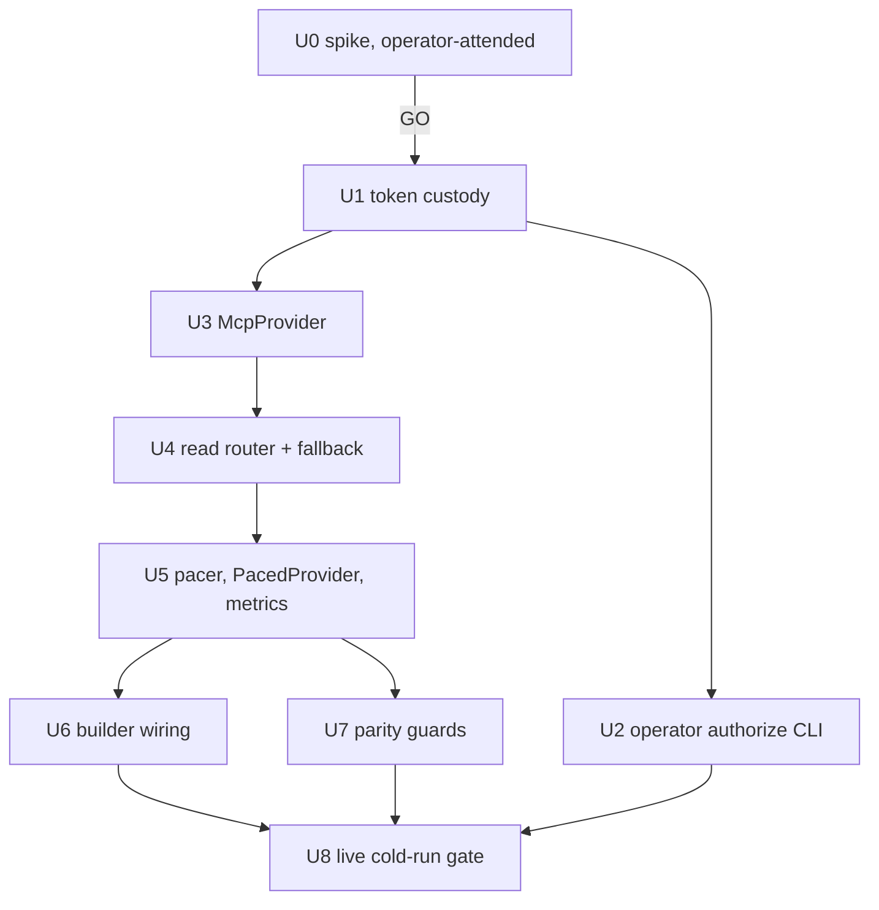

# Capacities MCP Read Provider - Plan

## Goal Capsule

- **Objective:** Bring a cold Capacities Refresh (390 objects, about 13 minutes today) down to about 3 minutes. Object content is read through Capacities' hosted MCP server instead of the REST content endpoint. Which objects count and how they are judged stay the same, and REST remains the automatic fallback.
- **Product authority:** this document. It builds on the 2026-11-05 latency plan, whose per-type publishing (U5-U7), one-shot transient retry, and `progress.metrics` are already landed and stay unchanged.
- **Open blockers:** U0 must return GO before any production unit starts. Headless OAuth refresh and quota independence are both unproven.

## Product Contract

### Summary

Only the content-read transport changes. Listing, structures, writes, admission, read order, and publication stay on their current paths. Content reads go to `capacities_getObjectContent` over MCP, which uses its own OAuth credential and quota and has been observed well above REST's 30 reads per 60 s. Any MCP authorization or session failure drops the run back to REST with one bounded warning, so a refresh never fails because of MCP.

### Problem Frame

- Every admission decision costs one content read, because REST listings carry no properties (`app/capacities_adapter.py:3785-3815`).
- `GET /object` is documented and measured at 30 per 60 s. That caps a 390-read cold run at about 13 minutes, and no pacing change shortens it (2026-11-05 plan, Outstanding Questions).
- A live probe through the harness MCP made about 140 `capacities_getObjectContent` calls. These were 100 in about 113 s and 60 in 23 s, plus 37 while TDTB's REST pacer was waiting. There were zero errors or throttles, and the object JSON matched REST.
- MCP authenticates with OAuth (scope `mcp:read mcp:write`), not TDTB's REST bearer token. Per-token REST quota is therefore not shared. An account-level quota is unproven.

### Requirements

**Parity**

- R1. For the same Capacities data, the admitted row set, published members, and read order are identical whether content is read through REST, MCP, or a run that falls back from MCP to REST partway.
- R2. Listing, structures, and patch stay on REST. MCP is used only for content reads, so enumeration and the "complete scope or nothing" install contract are unchanged.
- R3. Content returned from MCP is checked against the configured space and normalized to the REST content shape before the store sees it.

**Throughput and pacing**

- R4. MCP content reads are paced under their own endpoint budget. The budget is static and conservative, set from U0's measured ceiling. MCP pacing never consumes or delays the REST `content` budget.
- R5. A cold run through MCP finishes its read phase within the U8 target, measured from its own job document.

**Fallback and safety**

- R6. The run falls back to REST for its remaining reads, and still completes, if MCP authorization fails, the token file is missing or invalid, the session cannot open, the tool is unavailable, or MCP fails repeatedly. It adds exactly one bounded, secret-free warning.
- R7. Each run records `read_source` (`mcp`, `rest`, or `mixed`) and per-source read counts in `progress.metrics`.
- R8. MCP access tokens, refresh tokens, client secrets, authorization codes, and OAuth response bodies never appear in the repo, logs, job documents, warnings, exceptions surfaced to callers, or argv.
- R9. Initial OAuth consent is an operator-attended, operator-run step. TDTB never opens a browser, never starts an authorization flow from the server, and never performs dynamic client registration from the server.
- R10. Single-flight, cancellation, status-without-provider-call, interim publishing, and the one-shot transient retry are unchanged.

### Key Decisions

- **MCP replaces content reads only, not listing.** REST lists by structure id with cursor pagination (`capacities_adapter.py:3804-3815`). MCP lists by object type name (`capacities_listObjectsByObjectType(objectType, pageSize, cursor)`), and that mapping is unverified. Listing is a few dozen calls against 390 content reads, so moving it buys almost nothing and risks R1. `McpProvider.list_objects` is not implemented. A router delegates listing, structures, and patch to REST. U0 still records the structureId-to-objectType mapping as deferred evidence.
- **REST stays primary for writes and the fallback for reads.** `patch_object` is never routed to MCP, even though the scope includes `mcp:write`.
- **Sequential reads only.** The refresh assumes one in-flight request per endpoint (2026-11-05 plan, Assumptions), and the parity test asserts read order (`test_capacities_refresh.py:2387`). Concurrency is out of scope. If U0 shows per-call latency caps sequential throughput below about 130 reads per minute, the target is replanned, not met by parallelism.
- **Explicit setting toggles MCP (operator decision, 2026-11-06).** Enablement is a key in the strict Capacities settings document (`read_source`: `auto` or `rest`, default `rest`), which needs a settings schema version bump and a migration that leaves existing documents valid. MCP is used only when the setting is `auto` AND a valid machine-local custody file exists; the custody file alone never enables it. Setting `rest` is the kill switch. U6 owns the settings change.

### Acceptance Examples

- AE1. **Covers R1, R2.** Given the parity fixture, when one run reads content through a fake MCP session and another through REST, then members, admitted item ids, and read order are equal, and listing calls hit REST in both runs.
- AE2. **Covers R6, R7, R8.** Given an MCP session whose auth raises `OAuthTokenError`, when a cold Refresh runs, then `outcome: published`, `read_source == "rest"`, and exactly one fallback warning is present. No warning, job field, or captured log line contains the fake token strings.
- AE3. **Covers R1, R6.** Given MCP failing auth after object 2 of 4, when the run completes, then `read_source == "mixed"`, `mcp_reads == 2`, `rest_reads == 2`, and members, items, and read order equal the all-REST run.
- AE4. **Covers R3.** Given MCP content whose `spaceId` differs from the configured space, when it is read, then that read is a contract error (deterministic, not retried), and nothing from it is stored.
- AE5. **Covers R4.** Given MCP and REST budgets, when 40 MCP reads run, then the REST `content` window is untouched and MCP reads wait only on the `mcp_content` policy.

### Success Criteria

- A live cold Refresh's job document shows `read_source: "mcp"`, `rate_limited == 0`, `read_rate_per_minute` at or above the U0-derived budget, and a read phase of about 3 to 4 minutes for about 390 reads.
- Its final member set equals the previous complete REST generation for unchanged data.
- A run with the token file removed completes through REST with one fallback warning.

### Scope Boundaries

Deferred:

- MCP listing (`capacities_listObjectsByObjectType`) and any structureId-to-objectType mapping.
- Concurrent or parallel reads.
- MCP writes.
- `capacities_search` or `capacities_readObjectBlocks`.
- The REST `GET /object/markdown` second bucket.
- Automated or server-initiated re-consent.
- A cockpit UI for MCP auth state. The fallback warning travels on the existing refresh status surface.

### Dependencies / Assumptions

- `mcp==1.28.1` and `anyio==4.14.2` are already pinned (`app/requirements.txt:18,35`). No new dependency.
- `OAuthClientProvider` is an async `httpx.Auth` (`oauth2.py:217`). The refresh coordinator is synchronous and threaded (`capacities_refresh.py:1424`). The sync facade runs the async client on an `anyio.from_thread.start_blocking_portal()` portal (`anyio/from_thread.py:504`).
- Capacities' MCP authorization server supports refresh tokens and either dynamic client registration or CIMD. This is proven or disproven in U0.

### Outstanding Questions

- Resolved: `mcp` exposes `TokenStorage` (async `get_tokens`, `set_tokens`, `get_client_info`, `set_client_info`; `oauth2.py:72-90`) and auto-refresh when `is_token_valid()` is false and `can_refresh_token()` is true (`oauth2.py:500-508`).
- Resolved, risk: after a process restart, `_initialize` loads tokens but never sets `context.token_expiry_time` (`oauth2.py:475-479`). `is_token_valid()` then returns true for an expired access token (`oauth2.py:129-135`). The server answers 401, and the library starts the full authorization flow (`oauth2.py:512` onward) instead of refreshing. Headless, that raises `OAuthFlowError("No redirect handler ...")` (`oauth2.py:320-321`).
  - Mitigation (KTD3): custody persists an absolute expiry, and `McpProvider` pre-sets `auth.context.token_expiry_time` before the first request.
- Resolved, risk: on a 401 with no stored `client_info`, the library performs dynamic client registration before failing (`oauth2.py:572-594`). The server must therefore only run with stored client info. Custody refuses to construct the provider without it.
- Resolved, risk: a refresh response replaces `current_tokens` wholesale (`oauth2.py:463-467`). If Capacities omits `refresh_token` on refresh, the stored refresh token would be lost. Custody merges the old refresh token in (KTD2).
- Deferred to U0: how MCP throttling surfaces (HTTP 429 on the transport, a JSON-RPC error, or `CallToolResult.isError` text), and whether it carries Retry-After.
- Deferred to U0: whether `CallToolResult.structuredContent` is populated or the object arrives as one `TextContent` JSON string.
- Deferred to U0: access-token lifetime, refresh-token lifetime and rotation, and idle survival.

### Sources / Research

- The files listed in the evidence envelope.
- The live harness probe results supplied by root (2026-11-06).

---

## Planning Contract

### Key Technical Decisions

- KTD1. **A read router, not a replacement provider.** A new `CapacitiesReadRouter` in `app/capacities_read_source.py` implements the provider protocol.
  - It delegates `fetch_structures`, `list_objects`, `patch_object`, `base_url`, `supports_object_listing`, and `set_rate_observer` to the REST client. The REST header observer keeps working (`capacities_refresh.py:863-865`).
  - `get_object` goes to MCP while MCP is healthy, and to REST after a fallback.
  - It exposes `content_endpoint` (`"mcp_content"` or `"content"`) and `read_counts()` (`{"mcp": n, "rest": n, "fell_back": bool}`).
- KTD2. **Token custody (`app/capacities_mcp_auth.py`).** `FileTokenStorage` implements `mcp.client.auth.TokenStorage`.
  - It holds one JSON document: `{"version": 1, "client_info": {...}, "tokens": {...}, "access_expires_at": <epoch|null>}`.
  - Default path is `~/.config/tdtb/capacities-mcp-oauth.json`, a sibling of the existing credential slot (`capacities_builder.py:121`). It is outside synced folders.
  - The directory is 0700 and the file 0600. Writes are atomic: an `O_EXCL` 0600 temp file plus rename, the pattern at `capacities_settings.py:1253`. Like `load_capacities_token` (`capacities_builder.py:217-230`), any mode looser than 0600 is rejected.
  - `set_tokens` keeps the previous `refresh_token` when the new token lacks one, and stores `access_expires_at = now + expires_in`.
  - All errors are `CapacitiesMcpAuthError` with fixed messages: no path, no value, no response body.
- KTD3. **Headless-safe OAuth construction.** `McpProvider` builds `OAuthClientProvider(server_url, client_metadata, storage, redirect_handler=None, callback_handler=None)` (`oauth2.py:225-233`).
  - Before the first request it sets `auth.context.token_expiry_time` from `access_expires_at`. An expired token then refreshes instead of 401-ing into the full flow.
  - It refuses to start if stored `client_info` or `refresh_token` is absent. This prevents server-side registration (R9).
  - Any `OAuthFlowError`, `OAuthTokenError`, `OAuthRegistrationError`, HTTP 401/403, or `CapacitiesMcpAuthError` becomes `capacities_adapter.CapacitiesReadSourceUnavailable`, a new class with no message payload.
- KTD4. **Sync facade over one portal per run.** `McpProvider` opens the portal, the `httpx.AsyncClient(auth=...)`, the `streamable_http_client(url, http_client=client)` (`streamable_http.py:600-605`), and `ClientSession(...).initialize()` lazily on the first `get_object`.
  - `PacedProvider` gains duck-typed `begin_run()`/`end_run()` passthroughs. `RefreshCoordinator._run` calls them, with `end_run` in a `finally`. The session closes at run end, so no idle session spans runs.
  - Each `call_tool` has `read_timeout_seconds` of 15 s. Cancellation stays bounded by one in-flight call, because the pacer checks cancellation before every request (`capacities_refresh.py:726`).
- KTD5. **Result normalization (R3).** Prefer `structuredContent` when it is a dict. Otherwise parse a single `TextContent` as JSON.
  - `isError`, multiple content parts, non-JSON, or a non-dict `properties` raise `CapacitiesContractError` with a fixed message. That class is deterministic and not retried (`capacities_refresh.py:549-551`).
  - If `spaceId` is present and differs from the configured space, it is a contract error. The result is then projected to the REST key set fixed by U0's diff, which drops MCP-only keys such as `spaceId`. The store receives the same shape as REST.
- KTD6. **Pacing.** Add `ENDPOINT_MCP_CONTENT = "mcp_content"` to `DEFAULT_POLICIES` (`capacities_refresh.py:228-232`) with a static `EndpointPolicy`. The value is about 60% of U0's sustained ceiling, capped by the latency-bound sequential rate.
  - MCP has no header observer. The REST observer only ever reports REST endpoints.
  - A detected MCP throttle raises `CapacitiesRateLimited(retry_after=...)`. The existing `pacer.call` backoff and `rate_limited` count then apply unchanged on `mcp_content` (`capacities_refresh.py:822-852`).
- KTD7. **Fallback mechanics.** `PacedProvider.get_object` picks `endpoint = getattr(raw, "content_endpoint", ENDPOINT_CONTENT)` and calls `pacer.call(endpoint, ...)`.
  - When `CapacitiesReadSourceUnavailable` is raised, the router has already flipped to REST. `PacedProvider` immediately re-issues the same read with `pacer.call(ENDPOINT_CONTENT, ...)`.
  - The exception never reaches `_read_object`. It is neither an unreadable object nor a transient retry, so read order and per-object bookkeeping are preserved.
  - Non-auth MCP failures still pass through the existing one-shot transient retry. After 3 consecutive MCP failures, the router flips to REST as a circuit breaker.
- KTD8. **Metrics and warning.** `_build_metrics` (`capacities_refresh.py:1552-1605`) adds `read_source`, `mcp_reads`, `rest_reads`, and `read_source_fell_back`. `JOB_SCHEMA_VERSION` stays 1.
  - A fixed `MCP_FALLBACK_WARNING` constant joins the warnings, at most once per run: "Capacities fast read was unavailable; this refresh read through the standard API at the normal pace."
- KTD9. **Log hygiene.** The `mcp` library logs `Token refresh failed: <status>` and `logger.exception("OAuth flow error")` (`oauth2.py:456,597`). `_handle_token_response` builds exception text from the response body (`oauth2.py:411-414`).
  - `McpProvider` never re-raises library exceptions to callers. It installs a logging filter on the `mcp.client.auth` logger that drops records carrying `exc_info` and redacts the message to the logger name plus status.
  - A caplog test asserts no fake secret appears.

### Assumptions

- U0 shows the MCP payload matches REST field-for-field on the keys admission reads.
- Sequential MCP latency allows at least about 130 reads per minute. If not, R5's target is renegotiated.
- Only the TDTB server process refreshes tokens after consent. The operator authorize CLI runs only while no refresh job is active. Refresh-token rotation could race between processes, so a 0600 lock file guards `set_tokens`.

### Sequencing

U2 and U3 may run in parallel after U1, on disjoint files. All others run serially.

---

## Implementation Units

### U0. Feasibility spike (operator-attended, no production code)

- **Goal:** Prove or disprove the four unknowns before any production code is written.
- **Requirements:** gates everything; informs R4, R5, R6, R9, KTD3, KTD5, KTD6.
- **Dependencies:** none.
- **Owner:** the operator runs it. An agent may draft scratch scripts but cannot perform consent.
- **Files:** none in the repo.
  - Scratch scripts live outside the repo, for example `~/scratch/tdtb-mcp-spike/`. They are run with `app/.venv/bin/python -I` and use a scratch token file there (0600).
  - Evidence is a secrets-free summary appended to TDTB's restartable state surface.
- **Procedure:**
  1. **Headless refresh.** The operator consents once with a scratch `OAuthClientProvider` using a loopback redirect handler. Record whether registration was DCR or CIMD. Then, in a new process with `redirect_handler=None`:
     - (a) read 5 objects;
     - (b) force-expire the stored access token and repeat, with and without pre-setting `context.token_expiry_time` (confirms the KTD3 restart bug and its fix);
     - (c) idle at least 24 h (and ideally across a reboot), then repeat;
     - (d) record `expires_in`, whether refresh rotates `refresh_token`, and whether a refresh response omits it.
  2. **Quota independence.** Run TDTB's REST pacer pattern at 30 per 60 s for 3 minutes alone, recording REST `RateLimit` remaining values. Repeat while MCP reads run continuously in a second process. Independence means REST remaining/reset sequences and throughput are unchanged and there are zero REST 429s.
  3. **MCP ceiling and latency.** Read sequentially without pacing for up to 3 minutes or until the first throttle signal, capped at 600 calls. Record:
     - p50/p95 per-call latency;
     - sustained reads per minute;
     - the exact throttle shape (HTTP status, JSON-RPC error, or `isError`) and any Retry-After.
     Stop at the first throttle.
  4. **Payload diff.** For at least 40 objects, read both REST `GET /object` and MCP `capacities_getObjectContent` and diff field by field: key set, `properties` values, `tags`, `collections`, `lastUpdated` format. The sample includes:
     - empty-Status Projects;
     - label, date or date-range, and entity properties;
     - at least one object per mapped type;
     - `structuredContent` versus `TextContent` delivery.
     Also record for each type which `objectType` value MCP reports against REST `structureId`. This is evidence only; listing stays REST.
- **Go/no-go:**
  - GO requires all of these:
    - steps 1(b) with the fix and 1(c) succeed headless;
    - REST behavior is unchanged under concurrent MCP load;
    - the sustained sequential rate is at least about 130 per minute, or the operator accepts a lower target;
    - zero admission-relevant diffs in step 4 (key-set extras such as `spaceId` are acceptable).
  - **Stop rule:** if any headless refresh needs a browser, if the refresh token does not survive idle or restart, or if MCP and REST share a quota, stop. Record the evidence and close this plan as no-go. Do not build U1-U8.
  - A payload diff on any admission-read field is also no-go until a normalization rule is agreed.
- **Verification:** the summary records each criterion as pass or fail with numbers and contains no tokens.

### U1. Token custody module

- **Goal:** A file-backed `TokenStorage` that is safe headless and never leaks.
- **Requirements:** R8, R9; KTD2.
- **Dependencies:** U0 GO.
- **Files:** `app/capacities_mcp_auth.py` (new); `app/tests/test_capacities_mcp_auth.py` (new).
- **Size:** 2 files, about 25 tool calls.
- **Patterns:** `load_capacities_token` mode check (`capacities_builder.py:217-230`); the 0600 `O_EXCL` write (`capacities_settings.py:1253`); owner-only modes in `capacities_tag_titles.py:73,120-127`.
- **Test scenarios:**
  - round-trip `set_tokens`/`get_tokens`/`set_client_info`/`get_client_info` through `asyncio.run`;
  - the file is 0600 and the directory 0700;
  - a 0644 file is rejected;
  - a refresh without `refresh_token` keeps the old one;
  - `access_expires_at` is persisted;
  - error messages contain no path or token;
  - a missing file means "not configured", not a crash.
- **Focused test:** `python3 -m pytest app/tests/test_capacities_mcp_auth.py -q`.

### U2. Operator authorize CLI (operator-run only)

- **Goal:** One command the operator runs by hand to perform consent and write the custody file.
- **Requirements:** R8, R9.
- **Dependencies:** U1.
- **Files:** `app/capacities_mcp_authorize.py` (new; `python -m` entry, loopback `127.0.0.1` redirect on an ephemeral port using stdlib `http.server`); `app/tests/test_capacities_mcp_authorize.py` (new).
- **Size:** 2 files, about 30 tool calls.
- **Behavior:**
  - prints the authorization URL to stdout and opens no browser itself;
  - never prints or logs the code or tokens;
  - refuses to run when the refresh job lock is held;
  - is not imported by `main.py` or any route.
- **Test scenarios:**
  - with a fake `OAuthClientProvider` flow, the callback handler returns `(code, state)` and the file is written 0600;
  - caplog/stdout contains no fake code or token;
  - an import-graph test asserts `main` and `capacities_refresh` do not import this module.
- **Focused test:** its own test file.

### U3. McpProvider (content reads only)

- **Goal:** A synchronous `get_object(object_id) -> dict` over MCP that returns REST-shaped content.
- **Requirements:** R3, R6, R8; KTD3, KTD4, KTD5, KTD9.
- **Dependencies:** U1.
- **Files:** `app/capacities_mcp.py` (new); `app/capacities_adapter.py`, which only gains the `CapacitiesReadSourceUnavailable` class next to `CapacitiesRateLimited` (`:71-87`); `app/tests/test_capacities_mcp.py` (new).
- **Size:** 3 files, about 35 tool calls.
- **Interface:**
  - `McpProvider(space_id, storage, *, server_url="https://api.capacities.io/mcp", session_factory=None, timeout=15.0)`;
  - `begin_run()`, `end_run()`, `get_object(id)`, `close()`.
  - The injectable `session_factory` returns an async context manager yielding an object with `call_tool(name, arguments, read_timeout_seconds=...)`. Tests use it, so no network is touched.
  - The throttle mapping follows U0's observed shape.
- **Test scenarios:**
  - `structuredContent` and `TextContent` JSON both normalize to the REST key set;
  - `isError` or garbage raises `CapacitiesContractError`;
  - a mismatched `spaceId` raises `CapacitiesContractError` (AE4);
  - fake `OAuthTokenError`/401 raises `CapacitiesReadSourceUnavailable` with an empty message;
  - an expired stored token pre-sets `token_expiry_time` to the past;
  - missing `client_info` raises unavailable before any request;
  - the throttle shape raises `CapacitiesRateLimited` with `retry_after`;
  - caplog contains no fake secret.
- **Focused test:** `python3 -m pytest app/tests/test_capacities_mcp.py -q`.

### U4. Read router and fallback state

- **Goal:** One provider object that routes reads and owns the fallback flip and counters.
- **Requirements:** R2, R6, R7; KTD1, KTD7.
- **Dependencies:** U3.
- **Files:** `app/capacities_read_source.py` (new); `app/tests/test_capacities_read_source.py` (new).
- **Size:** 2 files, about 25 tool calls.
- **Test scenarios:**
  - listing, structures, and patch always hit REST;
  - `set_rate_observer` is forwarded to REST;
  - `content_endpoint` flips from `mcp_content` to `content` on unavailable;
  - 3 consecutive MCP errors flip it;
  - a success resets the consecutive count;
  - `read_counts()` is accurate;
  - with no MCP configured, the router is REST-only and reports `rest`;
  - `begin_run` resets per-run state and `end_run` closes MCP.
- **Focused test:** its own test file.

### U5. Pacer endpoint, PacedProvider routing, metrics, warning

- **Goal:** The coordinator paces MCP separately, re-issues a fallen-back read through REST, and reports the source.
- **Requirements:** R4, R6, R7, R10; KTD6, KTD7, KTD8; AE2, AE5.
- **Dependencies:** U4, for duck-typed attribute names. Fakes suffice, so no import of the router is needed.
- **Files:** `app/capacities_refresh.py`:
  - `ENDPOINT_MCP_CONTENT` and its policy at `:228-232`;
  - `PacedProvider.get_object`, `begin_run`, `end_run` at `:896-899`;
  - `_run` calling them at `:1469-1481`;
  - `_build_metrics` at `:1552-1605`;
  - `MCP_FALLBACK_WARNING` beside the warnings at `:125-177`;
  - the module-docstring "Endpoint-aware pacing" and "No secret leakage" bullets.

  Tests go in `app/tests/test_capacities_refresh.py`, plus a small fake router in `app/tests/capacities_refresh_helpers.py`.
- **Size:** 3 files, about 35 tool calls.
- **Test scenarios:**
  - AE5: 40 MCP reads leave `pacer._times["content"]` empty;
  - AE2: an unavailable signal on the first read leads to a REST re-read, `read_source: "rest"`, one warning, and published;
  - a fallback is not counted in `retried_reads` or as unreadable;
  - an MCP throttle increments `rate_limited` and waits on `mcp_content` only;
  - cancellation during an MCP-paced wait still cancels;
  - existing pacing, 429, budget, and cancel tests pass unedited;
  - status makes no provider call.
- **Focused test:** `python3 -m pytest app/tests/test_capacities_refresh.py -q`.

### U6. Builder wiring

- **Goal:** `build_refresh_coordinator` passes a router when MCP custody is configured, and plain REST otherwise.
- **Requirements:** R6, R9.
- **Dependencies:** U5.
- **Files:** `app/capacities_settings.py` (new `read_source` key, schema version bump, migration of existing documents; read the file and its validation tests first, they are strict) and `app/capacities_builder.py`:
  - `CapacitiesBuilderConfig` at `:1105-1128` gains `mcp_token_path: Path = DEFAULT_MCP_TOKEN_PATH`;
  - `build_refresh_coordinator` at `:1608-1640` reads the settings `read_source`.

  Tests go in `app/tests/test_capacities_builder.py` and the settings test file. If the settings change proves larger than one unit, split it into U6a (settings) and U6b (builder wiring).
- **Size:** 4 files, about 40 tool calls; split if over.
- **Rules:**
  - Setting `auto` with a valid custody file yields a router; a missing file or setting `rest` (the default) yields the bare REST client as today.
  - A custody file that exists but is loosely permissioned still builds REST-only, and the first run carries the fallback warning. The build never raises.
  - The legacy reader and write paths (`:1287`, `:1836`) are untouched.
- **Test scenarios:**
  - each of the three branches;
  - no network at build;
  - no token text in any raised or logged message.
- **Focused test:** `python3 -m pytest app/tests/test_capacities_builder.py -q`.

### U7. Parity guards

- **Goal:** Prove R1 across read sources.
- **Requirements:** R1, R2; AE1, AE3.
- **Dependencies:** U5 (U4 for the real router class).
- **Files:** `app/tests/test_capacities_refresh.py` only. It extends `_parity_evidence` (`:2326-2363`) with a `read_source` parameter that wraps `_paged_provider` in the real `CapacitiesReadRouter`, backed by a fake MCP provider serving the same `_content` objects.
- **Size:** 1 file, about 15 tool calls.
- **Test scenarios:** a new `test_the_admitted_rows_and_read_order_survive_any_read_source` compares members, items, and reads across four runs:
  - REST;
  - MCP;
  - MCP falling back after read 2 (`mixed`);
  - MCP with a tight `mcp_content` policy forcing waits.

  It asserts `fallback["items"] == ["A","B","C","D"]` so the comparison is not over empty results. Listing calls are REST-only in every run. The existing pacing parity test passes unedited.
- **Verification:** the focused pytest run passes. `git diff` shows no change to `items_for_day_from_objects`, `_needs_read`, `_read_or_reuse`, or `_read_object`.

### U8. Live cold-run measurement gate (operator-attended, no code)

- **Goal:** Confirm the target and parity from a real run.
- **Requirements:** R5, R7; Success Criteria.
- **Dependencies:** U2, U6, and U7 landed; the operator has run U2's CLI.
- **Operator steps:** restart the server (`tdtb-restart`, operator-only) and run a Rescan of all types.
- **Evidence:** the job document under machine-local `capacities-refresh/jobs/`, read only. Check `read_source`, `mcp_reads`, `read_rate_per_minute`, `read_started_at`/`read_finished_at`, `rate_limited`, `warnings`, and the final member set against the previous complete generation.
- **Second run:** the operator renames the custody file and runs a Refresh. It must publish with `read_source: "rest"` and the single fallback warning.
- **Verification:** the read phase is at most about 240 s for about 390 reads, `rate_limited == 0`, members are unchanged, and the fallback run publishes. Record the numbers in TDTB's restartable state surface.

---

## Verification Contract

| Scope | Command / check | Applies to |
|---|---|---|
| Custody | `python3 -m pytest app/tests/test_capacities_mcp_auth.py -q` | U1 |
| Authorize CLI | `python3 -m pytest app/tests/test_capacities_mcp_authorize.py -q` | U2 |
| Provider | `python3 -m pytest app/tests/test_capacities_mcp.py -q` | U3 |
| Router | `python3 -m pytest app/tests/test_capacities_read_source.py -q` | U4 |
| Refresh | `python3 -m pytest app/tests/test_capacities_refresh.py -q` | U5, U7 |
| Builder | `python3 -m pytest app/tests/test_capacities_builder.py -q` | U6 |
| Full backend | backend pytest suite incl. bootstrap runner tests (TDTB `AGENTS.md`) | every landing |
| Hygiene | `git diff --check` on owned paths; grep the diff for fake-token fixtures outside tests | every landing |
| Secrets | caplog and job-document assertions that no fake token, code, or body string appears | U1-U5 |
| Target | U8 job documents (MCP run and fallback run) | live gate |

Automated tests use injected `Clock`/`Sleeper`, `tmp_path`, and a fake `session_factory`. There is no network, no real credential, and no machine-local state.

---

## Definition of Done

- U0 recorded GO with numbers, or the plan was closed as no-go per the stop rule.
- U1-U7 are landed, each with its focused test and the full backend suite passing.
- U8 shows `read_source: "mcp"`, a read phase of about 4 minutes or less, `rate_limited == 0`, unchanged members, and a clean REST fallback run.
- No token, code, or OAuth body reaches the repo, logs, job documents, warnings, or argv.
- Server-side code never constructs an auth flow capable of browser consent or client registration.
- Single-flight, cancellation, interim publishing, and the transient retry are unchanged. The existing parity and pacing tests pass unedited.
- The module docstrings for `capacities_refresh.py` and `capacities_adapter.py:6` are updated, the latter to say "the adapter does not use MCP; content may be served by a routed transport".

---

## Deferred to Planning / Open Questions

- Deferred to U0: the MCP throttle signal shape, which fixes the U3 mapping.
- Deferred to U0: whether results arrive as structured or text content (U3).
- Deferred to U0: the `mcp_content` static budget value (KTD6).
- Deferred to U0: the access and refresh token lifetimes and rotation behavior (KTD2, KTD3).
- Deferred to U0: the REST key set to project MCP output onto (KTD5).
- Open: whether an account-level Capacities quota exists. U0 step 2 tests token-level independence only, so a long-term account limit could still appear. U8 and later runs watch `rate_limited`.
- Open: refresh-token expiry with no use (for example after a vacation). This causes a REST fallback, not a failure, but the operator must re-run U2. The fallback warning text could name that remedy. Decide before U5.
- Decided 2026-11-06: scope is content reads only (listing stays REST); consent uses a repo CLI the operator runs by hand (U2); enablement is a settings-document key (U6); if sequential MCP latency caps below ~130 reads/min the target is accepted at about 4 to 5 minutes, keeping read-order parity (no concurrency).
- Deferred: MCP listing by object type, once the structureId-to-objectType mapping from U0 is reviewed.

## Who does what

- **Root asks the user:** the four decisions below.
- **The user does by hand:**
  - U0 consent and the idle/reboot wait;
  - running U2's authorize CLI;
  - `tdtb-restart` before U8;
  - triggering the U8 Rescan and the fallback Refresh;
  - renaming the custody file for the fallback check.
- **Agents may do:** draft U0 scratch scripts outside the repo, run U1-U7 build dispatches in a TDTB worktree under `./.worktrees`, and read U8 job documents.
